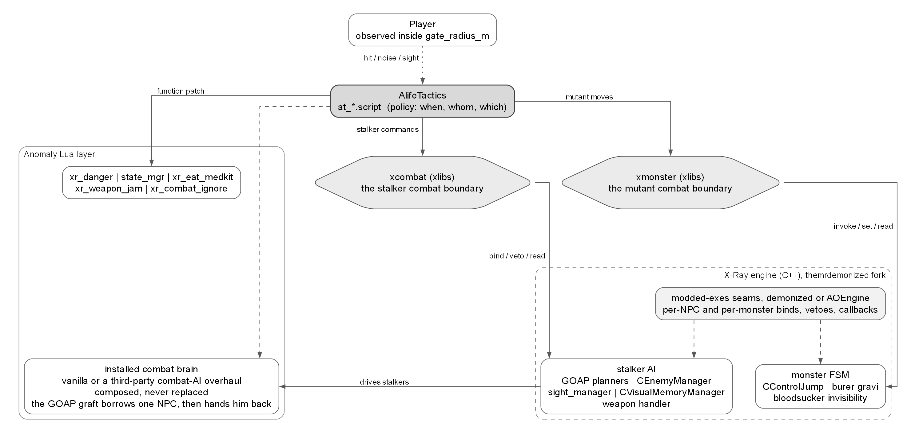
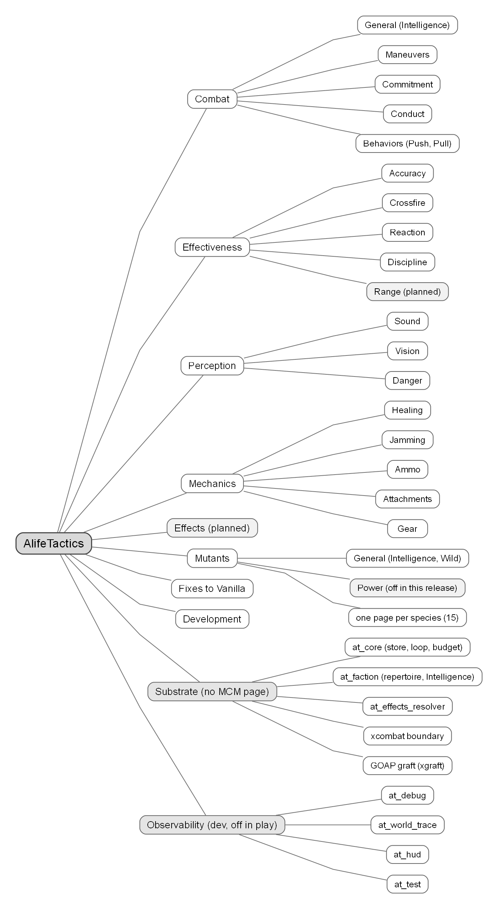

# AlifeTactics Architecture

AlifeTactics is a combat AI layer for STALKER Anomaly, for stalkers and mutants.
Each system reads the state of a fight, finds an opening, and decides through two rolls, Intelligence and Personality, whether the fighter takes it.
It runs on engine hooks and composes with the installed combat brain, vanilla or a third-party overhaul. It ships no vanilla script file.
It owns the combat axis of the Alife mod family and builds on xlibs: xcombat, xmonster, xsquad, xcreature, xttltable, xtime, xprofiler, xlog, xmcm, xinventory, xsmart, xslice, xgraft, xmath.



## Principles

- Compose, do not replace. A system attaches by a callback, a function patch, a DLTX overlay, a scheme patch or the time-boxed takeover. A file override does not ship.
- Engine first. Where Lua cannot reach a C++ decision point, the hook goes into the demonized build first and the mod consumes it second.
  A hook is probed at load, and its feature goes inert with an INACTIVE line when the hook is absent.
- One decision model for stalkers and mutants: a premise read, Personality as the repertoire the individual carries, one Intelligence roll at the moment of decision.
- Policy here, mechanism in xlibs. An engine call that needs a guard, carries a hidden meaning or needs a probe goes through xcombat or xmonster (`stalker-code.md`, xlibs wrapper criteria).
  Where a guarded wrapper exists, the raw call is a defect.
- Performance first. Only correctness and base gameplay outrank it. A feature over budget is reworked, dropped, or moved into an engine PR.
  A measured flow targets 0.1ms average per call under a 2ms ceiling. The monitor pass in a 40-stalker fight stays under 4ms.
- Event-driven. Work runs on a scheduled time event or a discrete engine event. A throttle placed after the dispatch of a per-frame carrier is per-frame work.
- Feed the engine. AT writes engine memory and state, and the engine runs its own combat on what was written.

## Container: the MCM tree

The container level is the MCM tree in `at_mcm.script`, 1:1 in grouping, order and names. Each MCM page is one Component section below.



- Combat: General, Maneuvers, Commitment, Conduct, Behaviors.
- Effectiveness: Accuracy, Crossfire, Reaction, Discipline, Range.
- Perception: Sound, Vision, Danger.
- Mechanics: Healing, Jamming, Ammo, Attachments, Gear.
- Effects.
- Mutants: General, then one page per species.
- Fixes to Vanilla.
- Development.

Range and Effects are placeholder pages without code. The mutant Power page sits in `at_mcm.script` behind `MUT_POWER_ENABLED`, false in the release.
The substrate has no MCM page: the combat record store, the faction gates, the effects resolver, the xcombat boundary and the GOAP graft.

## Control model

```
at_core._run_monitor every 200ms: re-arm -> per stalker record: dead or wounded -> clear, next
                                  -> actor_dist_sqr -> best_enemy refresh (600ms) -> maneuver begin (600ms) or update and end (200ms) -> Push, Pull
at_mutants._on_mob_update per binder tick (100ms near to 625ms far): contact lane -> adopt -> beat, once per 600ms per mutant
at_ammo._run_monitor every 5s: AP box decay
at_attachments._run_monitor every 3s: pending stalkers -> xslice, one per frame -> mount
at_healing._run_monitor every 200ms: limp pose and its drop checks
at_sound._run_pass every 500ms: accumulated step radius -> stamp hostiles inside it
at_world_trace, at_hud: registered only while their Development toggle is on
```


- `_run_monitor` registers from `actor_on_first_update` and re-arms after a save load, because time events do not survive a load. It re-arms first. An error costs a pass, not the loop.
- It arms only while Combat, Push or Pull is enabled.
- The per-event systems have no loop. Commitment runs on the action-switch and cover re-pick vetoes, Conduct on the body-state and combat-distance asks, Accuracy on the shot dispersion callback.
- `monster_on_update` is a scheduler-cadence callback, not a render frame. A cadence gate inside it is a legitimate carrier.

## Decision model

- Premise: a read of objective state finds an opening. Each premise is a named gate (Rules below).
- Personality: the repertoire, the set of moves an individual carries, rolled once per record over the moves its kind can make.
  The chances come from `[<action>]` in `at_faction_config.ltx` for stalkers and `[personality_<move>]` in `at_mutants_config.ltx` for mutants.
  A 0.8 move sits in 8 of 10 individuals, who take each opening their Intelligence passes. The other 2 do not carry it.
- Intelligence: (base + per-rank x rank index) / 100, capped at 0.75.
  The stalker pair keys to his rank (Combat General), the mutant pair to the map's danger tier (Mutants General, `xlevel.get_danger_tier`, 0 to 5).

The record owns the repertoire.
A stalker record is born at `npc_on_net_spawn` (`at_core._on_net_spawn` calls `at_faction.build_repertoire`), a mutant record at adoption (`at_mutants._build_repertoire`).
A later encounter rolls again.

A decision moment takes one Intelligence roll.
- A selection filters, shuffles, then checks conditions. The filter reads tables only: repertoire, MCM toggle, cooldown keys, and for stalkers the scope, weapon palette and loop guard.
  The survivors shuffle (`xmath.shuffle_back`, Fisher-Yates). The walk checks the conditions of up to 3 (`[select] candidates`, `[at_maneuvers] candidates`), and the first that fires wins.
  The cap counts condition checks only. The walks are `at_maneuvers._select_maneuver` and `at_mutants._select_move`.
- An independent opening checks the repertoire, then its premise, then rolls Intelligence: Push, Pull, the claw, the Liquidate deferral. A missed roll stamps the move's cooldown.

Lever shapes, by who owns the trigger:
- Per-opening action: AT fires it behind the repertoire and an Intelligence roll. The maneuvers, Push, Pull, Liquidate, and the mutant leaps, claw, backstrike, gravity throw and cloak.
- Panic: the inverse gate, taken on the Intelligence miss of the same beat. Flee, for stalkers and mutants. The gate token is `inv_int`.
- Persistent trait: rolled once and cached, because the engine fires the behavior itself. Conduct discipline, for the NPC's life.
- Wild: a value spread inside a bounded band, without a roll. The mutant ability numbers, the leap force and the steering gain.
- Correctness: a veto or vanilla repair without a premise or a roll. Commitment's switch denial, the danger scheme repairs, the targeting fixes.
- Skill scaling: a per-rank curve gated by `at_faction.is_participant`. The accuracy, aim, vision and discipline curves.

## Rules and invariants

- A maneuver clears the need that started it. A need the maneuver cannot clear picks the same row again, and the stalker loops on it. The `need_cleared=` field of the `[CMB] end` trace checks it.
- Gates are named, not inline.
  - `_can_<action>(obj)`: the engine-state gate, a boolean and a reason, xlibs predicates only, for example `_can_seize`.
  - `_check_<action>_block(...)`: the business gate, the premises plus `_can_<action>`, nil or a reason string, for example `_check_seize_block`.
  - Intelligence is a named roll, `at_faction.check_intelligence` and `_check_intelligence` in `at_mutants`. Personality is the repertoire on the record.
  - `_try_<action>`: one block check, then the act. The repertoire and cooldowns are filtered before it runs.
- Each `_npc_states` field has one writer.
- Debug is free when off. A trace gates on `at_debug.is_on()`, an integer compare, and the timers are null objects.
- A vanilla or xray fix appears on three surfaces: the readme under Fixes to Vanilla, the changelog as a Fixed vanilla bug line, the MCM Fixes tab.
- The MCM defaults in `at_mcm.script` are the only copy of the rank curves.

## Boundaries

```
xray-monolith (C++): the planners, CEnemyManager, the sound and visual memory, the monster FSM, the hooks AT consumes
  -> xlibs: xcombat (stalkers), xmonster (mutants), xgraft (the takeover), xttltable, xslice
    -> AT substrate: at_core (records, loop, budget), at_faction, at_effects_resolver
      -> AT systems, one module per MCM page group
anomaly scripts (xr_danger, state_mgr, xr_eat_medkit, xr_weapon_jam, rx_ff): patched in place by Danger, Healing, Jamming, Maneuvers
```

- A system reads the substrate through the `at_core` publics and writes the engine through xlibs.
- A system owns its own per-NPC state. The record store owns the shared combat facts.
- Observability modules read records through public getters and write no gameplay state.

## Substrate

### Combat record store

Does: holds one record per tracked stalker, the reverse threat index and the start budget (`at_core.script`).
Changes: nothing in the world.
Stops: the record is deleted in one teardown on `npc_on_net_destroy` and `server_entity_on_unregister`.

```
_npc_states[id] field           writer                    meaning
id, ran_at{}, repertoire        at_core (spawn)           identity, the per-check clocks, the Personality set
hit_at, hit_by                  at_core (hit)             the last landed hit: time and shooter id
reloading, reload_at            at_core (reload edges)    the reload window, from the engine reload events (PR #611)
actor_dist_sqr                  the loop                  squared distance to the player
best_enemy_id, best_enemy_at    the loop                  the engine's selection, refreshed every 600ms
gate, maneuver, dest, enemy_id  at_maneuvers              the takeover gate, open row, destination, committed target
window_starts                   at_maneuvers (start)      per-row starts inside window_limit_sec, an xttltable counter
push_*, pull*                   at_behaviors              the open press and pull windows
```

- `_best_enemy_of` maps a target id to the stalkers holding it as best enemy. The loop writes both directions. A reader takes candidates from `get_threats` and checks its predicates live.
- The start budget `_starts` is a sliding-window counter (xttltable) in four buckets: tier (`impose` for a maneuver, `compose` for Push, Pull, Liquidate) x target (player, NPC).
  The default is 6 per 10s each (`[at_core]` in `at_maneuvers_config.ltx`). Only a start spends.

```
check_start(bucket) -> bool             room in the bucket's window
add_start(bucket)                       spend one start
get_bucket(tier, is_actor) -> bucket    the bucket key
can_start() -> bool                     either impose bucket admits a start
get_combat_record(id) -> record|nil     the per-stalker record
get_combat_records() -> store           read-only, for walkers
get_best_enemy(id) -> id|nil            the selection fact
get_threats(id) -> bucket|nil           the reverse-index candidates
has_recent_hit(state, now, ms) -> bool  hit_at inside the window
is_enemy_back_turned(enemy, asker)      the enemy faces more than 90 degrees away from the asker
is_enemy_vulnerable(enemy, asker)       the vulnerability rule, with the term that fired
is_in_gate(state) -> bool               actor_dist_sqr within gate_radius_m (150m)
check_chance(p) -> bool                 the probability gate the repertoire rolls use
```

`is_enemy_vulnerable` answers whether an enemy can return fire now:
- Any enemy: a back turned on the asker.
- The player: the weapon block terms (`xcombat.get_block_reason`: unarmed, reloading, empty magazine), sprinting, climbing.
- A stalker: the block terms, a playing animation (`xcombat.is_body_busy`).
- A mutant: not covered.

### Faction gates

Does: rolls a stalker's repertoire from his faction's chances, and owns the stalker Intelligence roll.
Changes: nothing in the world.
Stops: a zombied stalker takes part in nothing. `is_participant` is the universal filter.

```
at_faction.script:
  is_participant(npc)              community ~= zombied
  build_repertoire(npc)            one roll per action (counterflank, reload_cover, flee, retreat, kite, pickoff, push, pull, liquidate)
                                   against [<action>] for his faction, else default, else 1.0
  check_personality(npc, action)   the per-call roll, for the Conduct trait only
  check_intelligence(npc)          one roll against min((int_base + int_rank_pct * rank index) / 100, [caps] intelligence)
```

### Effects resolver

Does: combines a per-NPC value that more than one source feeds, and owns its engine write. It is a registry of Strategy providers.
Changes: `set_view_distance_factor` and the aura at spawn, hit power on before-hit, dispersion on the shot callback.
Stops: a single-source value stays in its owning module.


```
register(effect, fn)     a source adds a provider (at_effects_resolver.script)
resolve(npc, effect)     max for a gain, min for a reduction, OR for the aura
apply_binds(npc)         re-applies the spawn-bound effects after a source invalidates its cache

effect           combine   sources
DAMAGE_DEALT     max       at_gear: electro, quest-special
DAMAGE_RESIST    min       at_gear: gravi, ballistic plates, the chemical interim
SHOT_DISPERSION  min       at_accuracy: the rank curve; at_gear: thermal
VISION_RANGE     max       at_reaction: the rank curve; at_gear: binoculars by day, night vision by night
AURA             OR        at_gear: any artefact class
```

- A provider walks the NPC on its first call and caches in its module. The `net_spawn` applier is the first caller. The walk stays out of hit and shot callbacks.
- The aura particle attaches at spawn on the configured bone or the first fallback bone, and dies with the game object.
  It has no stop path, because `stop_particles` trips the engine bone assert on a non-renderable bone.
- `at_compat.script` is a Decorator over grok_bo's `npc_on_before_hit`. grok_bo applies player-to-NPC damage itself and drops DAMAGE_RESIST.
  The wrapper heals back the resisted fraction of the health grok_bo removed. It installs at `actor_on_first_update` and is inert without grok_bo.

### xcombat boundary

Does: issues the combat commands and reads that need a guard, a meaning or a probe, one primitive per call.
Changes: weapon state, aim, movement, cover search, the cover reservation, the takeover.
Stops: it is stateless. AT owns when, whom and which maneuver. The primitive surface is in the xlibs architecture.

### GOAP graft

Does: gives the takeover a control point in the stalker's GOAP planner. While the gate is up, the planner reaches its goal only through AT's action.
Changes: an evaluator, an action and a block precondition on the motivation manager, once his logic is ready.
Stops: a companion is excluded while `combat_ignore_companions` is on.


```
npc_on_net_spawn -> at_maneuvers._register_graft -> xgraft.register_takeover(npc, SPEC), deferred until the logic is ready
  SPEC.gate -> the evaluator reads state.gate; SPEC.on_begin -> _start_maneuver; SPEC.on_release -> _on_release
TAKEOVER_ID 188347; each blocked planner gains the precondition 188347 == false
gate down   188347 false   the vanilla chain solves, the graft is dormant
seize       188347 true    the blocked actions are unselectable, initialize starts the maneuver
release     188347 false   vanilla resumes from where the stalker stands
```

- `initialize` clears animations, sets path, direction and danger mental state, registers in combat, then calls `SPEC.on_begin`.
- `apply_takeover_block` blocks the vanilla combat, danger and cover planners and the monolith, zombied, camper and facer sub-schemes (`xgraft.get_blocked_planners`).
  It runs on each seize, per NPC, because a world property added twice to one action throws (`condition_state_inline.h`).
- 188347 sits off the vanilla id range. Maneuvers take precedence over Behaviors and Commitment, and a seized stalker proposes no switch.

## Combat

Maneuvers impose. Commitment, Conduct and Behaviors compose.

The scope of Maneuvers, Push and Pull:
- Inside `gate_radius_m` of the player (`at_core.is_in_gate`).
- Against a human target, the player or a stalker, and not for a zombied stalker.
- A wounded man (`xcreature.is_wounded`) is neither an actor nor a target until he stands. The vanilla finisher handles him.
- Fights against mutants and fights past the gate stay vanilla.

### General

Does: holds the stalker Intelligence pair, `int_base` (40) and `int_rank_pct` (6).
Changes: the chance `at_faction.check_intelligence` rolls against.
Stops: capped at `[caps] intelligence` (0.75) in `at_faction_config.ltx`.

The page also holds Hit reaction hold (`combat_hit_hold`), a fix for every tracked stalker, maneuvering or not. Its code sits in `at_maneuvers.script` on the core loop.

- `npc_on_hit_callback -> _on_hit` raises `xcombat.set_movement_hold` (PR #645) on a staggering, flinching or standing stalker. The engine mover then keeps him in place with his path intact.
- `_update_hold` runs first in every pass of the core loop and releases the hold once the hit reaction ends, at most 2 s after the hit.
- The loop runs while this toggle is on (`at_core._apply_enabled`), and the option sweep releases every hold when it goes off, so a hold always has its release.

### Maneuvers

Does: seizes one stalker through the GOAP graft for one committed, time-boxed action, then hands him back.
The catalog rows are Strategies: each supplies `check_need`, `find_destination`, `update` and `check_end` (`at_maneuvers_config.script`).
Changes: destination, fire intent, posture and movement, set once and re-applied on the update check.
Stops: one open maneuver per stalker, bounded by the impose budget, ended on arrival, the cap or a broken premise, cleared on a wound, death and despawn.

```
begin (600ms, _try_begin_maneuver in at_maneuvers.script):
  fighting: a live best enemy or a hit within hit_fight_ms; a wounded enemy counts as none; the enemy is the player or a stalker
  _check_seize_block: not a companion, the graft registered, armed, outside smart cover, no playing animation, budget left
  _select_maneuver: Intelligence once; a pass walks the fighting rows, a miss the panic row (flee)
    _filter_rows: die side -> scope -> toggle -> repertoire -> palette -> loop guard
    shuffle -> up to 3 rows: check_need -> find_destination; the first destination wins
  _check_repeat_limit -> _try_seize: spend a start, apply_takeover_block, raise the gate, stamp row, destination, committed target
update (200ms, _update_maneuver): re-apply the row's state; skip while reloading or in a hit reaction
end    (200ms, _try_end_maneuver): check_end, arrival or the cap; a lost target ends it
```

```
maneuver      need                                        applies to                destination                          fire; move          ends on
counterflank  the player within 5m, the committed         a stalker fighting        holds, aims at the player            FIRE; STILL         3s
              target farther (check_actor_close)          someone else
reload_cover  reloading, a watcher has him in sight       per faction               nearest hiding cover                 READY; RUN          arrival, reload done, 8s
              (check_reloading_watched)                                             (xcombat.get_quick_cover)
flee          hurt, a threat in reach, the last man,      per faction, on the       a friendly base 100m+ away,          STOW; RUN           arrival or 20s
              not under fire (check_hurt)                 Intelligence miss         away from the threat
retreat       hurt, his spot exposed to a threat in       per faction               the best cover behind him            FIRE; WALK          arrival or 8s
              reach (check_hurt_exposed)                                            (xcombat.get_best_cover)
kite          a threat inside his weapon minimum          per faction               a clear lane back, length by         FIRE; WALK          arrival or 8s
              (check_too_close)                                                     weapon kind
pickoff       stalled 4s, past the enemy's effective      per faction               holds                                single shots; STILL 8s or premise broken
              range, unbothered (check_stalled)
```

- Retreat clears "hurt and exposed" on arrival, and reload cover clears "reloading and watched".
- Retreat's exposure test is `xcombat.is_concealed` at the STRICT floor `get_best_cover` picks by. Without concealed cover in reach, retreat takes a clear lane back (`xcombat.find_free_lane`).
- The committed target is the staged id. Update and end resolve it and do not read best_enemy again. A dead or despawned target ends the maneuver.
- Fire intent goes through `xcombat.set_combat`. A reloading weapon degrades it to READY, because a fire goal mid-reload cancels the engine reload.
- The burst shape patches `state_mgr_weapon.get_queue_params` (`_compute_queue_params`): size and pause rolled per query inside the engine's per-weapon medium band, times the Discipline factors.
  A stalker outside a maneuver passes through unchanged.
- The stuck guard (`_check_repeat_limit`, `repeat_limit` 3) refuses the same situation picked again within 2m.
- The loop guard (`_check_window_limit`, `window_limit` 4 per `window_limit_sec` 60, kite 6) refuses a row a stalker started too often, wherever he stands. `<row>_window_limit` overrides one row.

### Commitment

Does: holds a stalker on a winning fire action. It is a veto on two engine hooks.
Changes: it answers deny on a proposed action switch or cover re-pick.
Stops: it only denies. A transition that does not leave a fire action passes.

```
npc_on_combat_action_switch (PR #595, xcombat.on_action_switch) -> _on_action_switch: flags.allow = false (at_commitment.script)
  kill_enemy, kill_if_not_visible -> take_cover, get_ready_to_kill : held while he sees the enemy, the lane is clear (can_kill_member), fire_make_sense
  detour_enemy -> take_cover                                       : held while blind, released on sight
npc_on_best_cover_repick (PR #607, xcombat.on_cover_repick) -> _on_cover_repick: denies the swap that clears InCover
```

- `kill_enemy` (`stalker_combat_planner.cpp`) requires `InCover`, and a re-pick clears it before the exit is proposed. Holding the cover keeps the exit unselectable.
- `commitment_hold_s` (6s) caps one continuous refusal. An allowed switch resets it.
- At the cap, Liquidate defers up to `vulnerable_extend_ms` (4000) while `at_core.is_enemy_vulnerable` holds (`_try_extend_hold`).
  It needs liquidate in the repertoire. The first deferral rolls Intelligence and spends a compose start. A failed roll or a dry bucket ends the hold.

### Conduct

Does: cover posture and weapon spacing on vanilla-driven stalkers. It is an Observer on two engine asks that answers one value.
Changes: the body-state answer, and the combat-distance band.
Stops: a seized stalker reaches neither callback.

```
npc_on_combat_set_body_state -> _on_combat_body_state (at_conduct.script)
  hold_position only (stalker_combat_actions.cpp); rifles and snipers, experienced and up, the discipline roll; stand inside 20m
  the decision held for decide_ms (5s): crouch when the crouch-eye shot ray is clear (xcombat.has_shot_obstacle), else stand
npc_on_get_min/max_combat_dist (#563, xcombat.on_get_min/max_combat_dist) -> the engine's band, scaled behind the discipline roll
  SMG maximum x0.6, sniper minimum raised by rank; the Push cap and the Pull band apply here as overlays
```

- A handler scales the base the engine hands it and keeps its weapon-type meaning.
- The posture decision is held because the engine asks several times a second and the crouch line flips.
- Discipline is one roll per stalker, Intelligence then `[conduct]`, cached for his life, gating both habits.

### Behaviors

Does: Push presses a stalker whose target cannot answer. Pull pulls back a stalker in his own weak moment while his target stays strong.
Changes: Push raises the fire queue and tightens the cover maximum. Pull raises the cover minimum.
Stops: each write reverts within a pass when its cause clears. A seized stalker does not press or pull.

```
at_core loop -> at_behaviors.update_npc per record (scan only)
Push (_update_push_npc): in the gate, a human target, push in the repertoire, the press cooldown spent, a participant
  cause: is_enemy_vulnerable (push_reload) or the target weak with hysteresis (push_finisher)
  check the compose bucket -> Intelligence (a miss stamps the press cooldown) -> writes -> the first write spends the start
  FIRE: the queue raised by range band (close 15m, far 45m); BAND: a closer cover maximum on an advantage (bleeding, back turned, himself healthy)
  capped at push_window_max_ms (8s)
Pull (_try_open_pull, _update_pull_npc): pull in the repertoire, reloading or hurt after a recent hit, the target strong
  check the compose bucket -> Intelligence (a miss stamps the pull cooldown) -> spend the start -> at_conduct.set_pull_band; held at least 8s
```

- Pull outranks Push. The Conduct handlers apply the pull overlay after the push cap.
- A write happens on a transition against the per-NPC mirrors, and clears on cause end, toggle-off, seize, a wound, death, despawn and unregister.

## Effectiveness

Effectiveness is per-NPC skill on vanilla-driven fire and perception, whatever drives the stalker.
A rank curve is a base and percent-per-rank pair over the 8 ranks: value = base * (1 + pct% * rank index), floored at 0.01.
Reaction, Vision and Discipline share `at_reaction.script`. `set_aim_params` writes aim, lock and lead in one engine call.

### Accuracy

Does: gives NPC dispersion a per-rank curve.
Changes: the flat curve as a SHOT_DISPERSION provider, the moving-fire curve on `npc_shot_dispersion` while walking or running.
Stops: a page toggle off passes the shot through.

The engine rank knob does not work on Anomaly: `Rank()` clamps to 0-100 (`ai_stalker.cpp`) while Anomaly ranks run to 26999.
Each NPC gets the shared constant `m_fRankDisperison` (`ai_stalker_fire.cpp`).

### Crossfire

Does: scales damage between stalkers who are not enemies.
Changes: `shit.power` x `crossfire_factor` (0 by default) on `npc_on_before_hit`, without a throttle.
Stops: enemies (`xcreature.is_enemy`) take full damage, and the player as shooter is excluded. It keys on the relation, not the community.

### Reaction

Does: aim speed, tracking lock and target lead per rank, plus the two always-on targeting fixes.
Changes: a bind at spawn, and a lead recompute on the shot callback.
Stops: aim stays under the max aim angle and above the global baseline. The player's difficulty holds.

```
npc_on_net_spawn -> apply (at_reaction.script):
  set_hit_redirect(900, 60m)                       (PR #636) the last attacker's cost drops by up to 900, to 0 at 60m
  set_visible_enemy_bias(selection_actor_bias, -1) (PR #637) the player pull, 300 by default, 900 vanilla
  set_aim_params(npc, -1, track, aim, -1)          (PR #594) the aim and lock curves; -1 where the global is already stickier
npc_shot_dispersion -> _on_shot_lead, 1s per NPC: predict = clamp(range / bullet_speed * lead factor, 0, 0.5)
  bullet_speed = the section's bullet_speed x the loaded round's k_bullet_speed (predict_object_position, sight_action.cpp)
```

- The targeting binds are vanilla fixes on the Fixes tab, outside the page toggles. Player target pull is a slider on the Danger page.
- `fire_make_sense` still requires line of sight.
- Tracking lock: base 0.196, +12% per rank. Lead factor: base 2.00, -7.4% per rank.

### Discipline

Does: burst size and cadence per rank. The defaults are a near-flat band.
Changes: `set_fire_queue_scale` at spawn (PR #603), and `get_queue_scales(npc)`, the owner of the rank tables, read by maneuver fire and the Push restore.
Stops: the interval floors at 0.60, and the defaults keep each rank's rounds per minute at or above vanilla.

A state_mgr fire state reaches the object handler with explicit parameters. Maneuver fire multiplies the same factors through `get_queue_scales`.

### Range

A placeholder page without code. Its subject is the engine's fixed NPC fire range cap.

## Perception

Sound and Vision detect. Danger owns the reaction scheme they stamp into.

### Sound

Does: opens a stalker's sound memory to the player before contact, stamps the danger scheme for player noise the memory drops, and turns a standing stalker toward a creature he hears.
Changes: the `on_enemy_eval` answer, the `xr_danger.set_script_danger` stamps, a look target.
Stops: crouched movement is silent. A neutral hearer gets neither the answer nor a stamp from player noise. A creature sound stays out of the danger scheme. A heard shot stays with the engine.

```
npc_on_hear_callback -> _on_hear (at_sound.script), a hostile hearer, a player source:
  _set_store_window: power x type factor >= the install's keep floor -> _store_open_at[id] = now
  reload, empty, item-use within their radius -> a stamp at the sound position
on_enemy_eval -> _on_enemy_eval: a window under 500ms, the player as enemy -> flags.override, flags.result = true
  asked inside the store: CSoundMemoryManager::add -> CEnemyManager::useful -> xr_combat_ignore.is_enemy
actor_on_footstep, actor_on_land -> noise radius = 5m x stance (crouch 0, sprint 1.6) x surface x MCM multiplier x hearing scale
_run_pass (500ms) -> cut by rain -> stamp each hostile in db.OnlineStalkers inside the radius (4s per stalker)
creature MST_* sound (a mutant, or a hostile stalker) -> _try_glance: standing, out of combat, 8s per stalker -> a same-state look refresh
```

- On the multi-thread exes the store asks `is_enemy` before keeping a sound, and the answer is no without a recent memory of the player. The window answer fills that gap.
  The chain is in `doc/library/xray/internals/npc-hearing.md`.
- The window yields to a subscriber that already set the flags, to the hearer's combat-ignore overrides, and to bribe peace.
- The hear callback runs before the store (`CSoundMemoryManager::feel_sound_new`). An empty window table makes the idle cost one check.
- The hearing scale follows the installed stalker hearing config.
- A walk is below the 0.5 keep floor always, and a run past about 6m. The stamp channel covers those steps, in script, without writing the engine's sound memory.
- Stealth is a vision system. Sound does not touch vision, seen memory or the sight test.
- Neutral gunfire alert (`danger_neutral_gunfire`) governs the stamp vanilla puts on a stalker whose feet the player's bullet strikes within 30m (`xr_danger.npc_on_hear_callback`).
  The engine drops a neutral's heard shot in the store (`CSoundMemoryManager::add`). `_has_admitted_stamp` in `at_danger.script` admits the stamp for a neutral or friend while the toggle is on.

### Vision

Does: acquisition speed and view range per rank.
Changes: `set_vision_speed` at spawn, the step of the detection accumulator (`visual_memory_manager.cpp`), and a VISION_RANGE provider.
Stops: the formula has no transparency term. Speed does not see through cover. Speed starts at vanilla for a novice and rises 2.9% per rank.

### Danger

Does: layers fixes and two improvements onto the installed xr_danger. The reaction matches what a stalker perceives. It is a function patch over 7 entry points.
Changes: the winning xr_danger's entry points at `on_game_start`, and AT's evaluators and action on each stalker.
Stops: it ships no xr_danger.script and does not contest the MO2 slot. The winner's hear and death feeders keep running.


```
on_game_start -> _install_patches (at_danger.script): setup_generic_scheme, add_to_binder, configure_actions, reset_generic_scheme,
  get_danger_time, set_script_danger, has_danger
add_to_binder -> at_evaluator_danger + at_action_danger on the motivation manager
plan solve -> eval_danger -> eval_danger_raw, then npc_on_eval_danger on a would-be-true verdict (a veto clears the inertion latch)
  a live admitted script_danger stamp -> true
  else the best danger -> the inertion and ignore tables of the winner's xr_danger.ltx -> danger_flag
at_evaluator_check_danger: attacked, corpse, grenade to the script; sound dangers stay with the engine planner
at_action_danger:execute -> the stamp first, else grenade, corpse or attacked; requires property_enemy == false
```

Stamp grades:
- faint: a standing stalker turns weapon-ready toward the position. A walking one ignores it.
- solid: he walks over (raid).
- watch: the knife grade, `threat_na` looking at the source. It ranks with solid.
- rush: he runs. Companions only.
- An unexpired stronger stamp survives a weaker one.
- The grades above faint aim with a look direction (`_get_look_target`), not a position.
  The reason: the state manager counts a position as reached while the sight carries an animpoint direction (`state_mgr_direction.script`).
  The vector lives on the stamp record, one per stalker.

The reaction:
- The active reaction runs 8.5s to 12.5s, one stage-2 give-up band, then a standing watch until the config inertion decays.
- `_is_squad_engaged` skips it while a squadmate holds a live enemy, memoized 500ms per squad.
- The install adds the monolith sub-scheme's four actions to `state_mgr.combat_action_ids`.
- It patches three rx_ff members: the friendly-fire freeze, the over-hold, and the blocked-shot lane test.

Toggles on the Danger page:
- Distant hits (`danger_hit_bypass`) answers a hit danger past the ignore distance, after the relation, alive and combat-ignore checks.
- Attempted murder (`danger_knife_miss`) stamps the stalker a missed knife swing was meant for, without a relation check.
  - `actor_on_hud_animation_mark`, hud state 5 or 6, a knife -> `_find_swing_target`: the nearest stalker within `knife_miss_m` (3m) and 45 degrees of the camera -> a 0.3s event.
  - A connecting hit reaches `npc_on_before_hit` within three frames (`Level_bullet_manager_firetrace.cpp`) and clears the event. On a miss, the event stamps watch.
  - It uses `threat_na`, because `threat_danger`'s `bloodsucker_search` animation owns the look. A neutral or friend takes the Neutral gunfire admission. The knife stamp skips the 4s throttle.
  - A stalker on the camper job does not reach the action (`xr_camper.script`).
- Player target pull (`selection_actor_bias`) is the Reaction bind.

The DLTX `mod_xr_danger_at.ltx` deletes the dead perceive keys of the `danger_object` name collision (`danger_object.h`). Detection distances come from the winning xr_danger.ltx.

## Mechanics

### Healing

Does: active first aid: a heal-rate multiplier, a pause while fighting, a per-rank medkit charge, a limp and heal gesture.
Changes: three xr_eat_medkit members at `on_game_start`, the charge at spawn, the limp pose on a 200ms monitor.
Stops: bleed staunching stays vanilla. The animations play within 50m of the player.

```
on_game_start -> _register_heal_patch (at_healing.script): heal_hp, heal_bleed, consume_medkit
  _update_heal_hp: change_health x the multiplier; ResetTimeEvent while engaged (a live enemy, the weapon out or within 5m)
zzz_at_healing_patch: unregisters vanilla xr_eat_medkit.on_register (the save-load charge re-roll)
mod_xr_eat_medkit_at.ltx: the medkit and bandage lists vanilla [plugin] omits
_run_monitor (200ms): the limp pose, checked each 1s; dropped when its gait stops matching
```

A queued script animation suspends the engine's animation selection (`stalker_animation_manager_update.cpp`). The limp pose drops the moment its gait stops matching.

### Jamming

Does: drops the misfire roll the modded exes inject for NPCs. It is a Decorator over the misfire functor.
Changes: `xr_weapon_jam.GetConditionMisfireProbability` returns `base_value`, the wear misfire `Weapon.cpp` computes, while enabled.
Stops: off, it forwards to the original. The player's weapon is untouched. Without the functor it logs INACTIVE.

### Ammo

Does: a veteran-and-up stalker fires AP from the loose ammo he carries, with one box decay per fight.
Changes: `wpn:set_ammo_type`, and an inventory box delete.
Stops: inert while `g_ai_unlimited_ammo` is 0, because the engine then spends real rounds.

```
_run_monitor (5s) -> update_npc (at_ammo.script): rank >= min_ap_rank, a live weapon, an AP class it takes
  in combat: hold m_ammoType on the AP index while AP is carried
  at peace (no best enemy for peace_debounce_ms): roll the decay, release one AP box, type 0 when empty
```

The inventory is the budget. A deleted box is permanent, because `try_advance_ammo` (`object_actions.cpp`) refills surviving boxes only. Decay is per fight because no NPC fire callback exists.

### Attachments

Does: a stalker mounts a loose scope, silencer or grenade launcher that fits his pistol or rifle, at the next quiet moment.
Changes: the gun's addon flag, or for a scope on an Anomaly base gun, a swap to its scoped variant with a new id.
Stops: it waits out a fight, a busy body and smart cover. It skips a gun the player or a quest claims, and story, named and story-squad stalkers.
A gift the player hands a companion stays as given (`axr_companions.script`).

```
npc_on_item_take -> an attachment marks the stalker pending (also with the toggle off)
_run_monitor (3s) -> snapshot the pending set -> xslice, one stalker per frame (at_attachments.script)
_run_slice_item -> _try_mount: _check_mount_block (toggle, participant, xcreature.is_unscriptable_se, no best enemy, _can_mount)
  combat, busy, smart cover -> stays pending; other blocks -> dropped
  the first loose attachment_slot_2 or _3 item that fits, pistol first -> xinventory.try_add_attachment; one mount per stalker per pass
```

- The mount runs outside the take callback. The engine attach checks no item state, and the item's destroy reaches the client a frame later.
  A mount in the callback could put vanilla's item on a second gun.
- One mount per pass keeps a second swap off a gun still spawning (`Level.cpp`, spawn antifreeze). A swap costs about 1ms. The pass spreads stalkers one per frame.
- The batch walks a snapshot array. The cleanup handlers clear only a stalker already pending, since a nil store to a missing key inserts it (`lj_meta.c`).
- The feature saves nothing. The pending set rebuilds from `npc_on_item_take` after a load.

The fight effects are the engine's:
- Scope: a still, aiming stalker uses the zoom dispersion keys (`ai_stalker_fire.cpp`), a cone about a third tighter.
- Scope sight range: a scoped variant keeps its base gun's `holder_range_modifier` (`Weapon.cpp`).
- Silencer: a different shot sound. Other NPCs hear him at the silenced sound's AI range (`doc/library/anomaly/internals/sound-source-and-emitter.md`).
- Grenade launcher: visual only.

### Gear

Does: gives an artefact one combat edge by its anomaly class, scaled by its tier.
Changes: five resolver providers, plus the passive regen bind.
Stops: one artefact tops out at 10%, and the strongest source wins.

```
on_game_start: register DAMAGE_DEALT, DAMAGE_RESIST, SHOT_DISPERSION, VISION_RANGE, AURA providers (at_gear.script)
first resolve per NPC: one inventory walk, the strongest strength per effect, cached
npc_on_item_take, npc_on_item_drop -> re-resolve a cached record
npc_on_net_spawn -> set_health_restore_boost (the n039 bind); without it the chemical strength joins the resistance pool
```

Detection is by section name, from the class lists in `at_gear_config.ltx`. Optics read day or night at the provider.

## Effects

A placeholder page without code. Its subject is player-facing combat feedback such as concussion.

## Mutants

The mutant module runs the decision model without a takeover. The engine FSM stays the only mover. AT varies values at adoption and commands moves the engine validates.

### General

Does: adopts each online mutant, rolls its repertoire and leap numbers, and runs the decision model once per 600ms beat.
Changes: per-object ability parameters at adoption, as multipliers over the install's LTX values. In a fight, single invokes and proposal windows.
Stops: inert without the monster hook set, with an INACTIVE line. A move fires only inside its species envelope (`[moves]`). A companion mutant is left alone while `combat_ignore_companions` is on.
On toggle-off it releases what it owns live: a gravi force, a cloak, a steering gain, an armed backstrike.

```
monster_on_update -> at_mutants._on_mob_update
  each update -> contact lane: leap outcome, steering restore, claw
  a record idle past STALE_MS (12s) drops; the mutant is adopted again
  adopt: species, map tier, [moves], repertoire, leap force, lead gain, Closing reach, jump auto-aim basis, gravi band, Wild offsets
  beat (600ms, _update_mutant): upkeep -> distance and motion sample -> held window (flee, gravity) skips -> is_in_gate -> Intelligence
    miss -> flee
    pass -> _filter_moves (repertoire, toggle, cooldowns) -> shuffle -> up to 3: leaps / gravity / cloak / backstrike, the first fire wins
monster_on_combat_action -> proposes the run-away substate while a flee window holds
before-hit callbacks: damage dealt (shit.draftsman) and taken (monster_on_before_hit); a 1.0 track skips the write
```

The General page holds `mut_int_base` (40), `mut_int_rank_pct` (6) and `mut_wild` (50).
- Intelligence: (base + per-rank x map tier) / 100, capped at `[intelligence] cap` (0.75).
- Personality: `[personality_<move>]` per species, rolled into the repertoire at adoption. A species favours one or two leaps at 0.7 to 0.8 and dislikes others at 0.3 to 0.4, and each row is above 0.
  The tables follow the lethality ladder in the Personality header of `at_mutants_config.ltx`. Burer, controller, bloodsucker and poltergeist sit off the ladder.
- Wild: 0 identical, 100 the widest spread. It varies a standalone ability number by up to `[wild] ability_pct` (0.20), the jump force `CControlJump` fits its glide to, and the live steering gain.
  It leaves alone the values a capture-start gate, a path builder or a prepare trace reads: the jump distances, `jump_build_line_distance`, `Run_Attack_Dist`.

Pacing:
- `[cooldown]` holds one row in ms per key, kept per mutant in `rec.ready_at` (`_check_cooldown`, `_add_cooldown`). A key without a row does not cool down.
- A move waits on its own key and the shared `any_move` row (10000). `_check_ready` names the blocking key, and `_add_fired` stamps both.
  Own rows: a leap 20000, claw 10000 (stamped on each roll), backstrike 10000, gravity 8000, cloak 5000, flee 120000.
- The gravity relay stamps the same key on an engine-fired throw.
- The player throttle is an `xttltable` token bucket of capacity 1: one offensive move against the player per `[caps] player_gap_ms` (2000), from all mutants.
  Check before the fire, take the token after.
  The offensive moves are the leaps, claw, backstrike and gravity. Flee, cloak and moves against NPCs pass.

### Species pages

A species page lists the moves the mod drives for that species, in up to three sections in this order:
- NEW MOVES, attacks vanilla does not fire for the species: the seven leaps, claw, backstrike, flee.
- MANAGED MOVES, the creature's attacks this mod times: the gravity throw, the cloak.
- INFLUENCED MOVES, abilities whose numbers Wild spreads at spawn: gravity numbers, telekinesis, psi tube, stamina, aura, detection.

The pages are chimera, bloodsucker, burer, controller, poltergeist, dog, boar, snork, pseudodog, gigant, cat, flesh, fracture, karlik, tushkano.
`[pages]` folds a subclass into its base page: lurker under chimera, psysucker under bloodsucker, psy_dog under pseudodog.
A row's tooltip ends with its gates: `(int, pers)`, `(int, pers, wild)`, `(wild)`, `(rank)`. A correctness row has none.

The moves:
- The leap family: seven handlers, each with its own premise, Personality row and cooldown row, sharing the launch path and one sight gate.
  - A leap is the species' jump through `xmonster.try_monster_jump`. Its damage is the jump's hit test (`CControlJump::hit_test`).
  - High, Hunting and Catching keep the species crouch (the `LAUNCH` table). The others set `ePrepareSkip`.
  - The chimera class, shared by the lurker (`SM_CHIMS`), loads no prepare motion (`CChimera::Load` -> `load_jump_data`).
    `CControlJump::start_jump` finds none and goes to the glide (`eGlideOnPrepareFailed`). Its leaps have no crouch.
  - The force is rolled once at adoption: `jump_factor`, or `[leap] basis` (2.0), times a Wild band of 1.0 to 1.5.
  - Inside `[leap] min_m` (3m) only High leap and the Closing leap toward a perch fire. The claw owns that range.
  - High leap fires at a perched enemy (`_is_enemy_perched`): above the mutant and inside its jump reach (`jump_max_distance`, else 15m).
    The enemy also stands 0.8m higher (`[premises] above_m`) or off the navmesh by more than `perch_gap_m` (1.0).
  - Punishing leap: the enemy aims at the mutant (`xcombat.is_enemy_watching`, `[threat] aim_cone_deg` 15) or is vulnerable.
  - Hunting and Feral leap: the enemy moved over `[motion] move_min_m` (0.5m) since the last beat.
    They steer in flight through the `set_monster_jump_flags` auto-aim, gain 0.3 to 0.6, restored on touchdown.
  - Catching and Cutoff leap: the same premise. The lead is the enemy velocity x the engine flight time (`xmonster.compute_jump_time`) x an Intelligence gain, capped at `[lead] max_m` (1m).
    Off the navmesh or refused, the leap takes the unled point. They do not steer.
  - Closing leap, the bloodsucker and psysucker gap-closer: a perched enemy within 15m, or the player aiming from 4.5m to 15m (`[closing_leap]`).
    The jump config does not load (`CAI_Bloodsucker::Load`). The claws strike after it lands.
  - Sight gate: the enemy sensed within `[leap] sense_ms` (1000) by the mutant's enemy memory (`xmonster.get_enemy_unseen_ms`).
    The engine's own check reads the instant see bit (`CControlManagerCustom::check_attack_jump`).
  - Feasibility: `xmonster.try_monster_jump` mirrors `can_jump`, which `script_try_jump` bypasses: restrictor, distance band where `jump_max_distance` exists, angle, height, force above 0.
  - A leap refuses while a jump holds the body. `[MUT] FIRE` logs the launch and `[MUT] LEAP ... end=land|abort|stuck` the outcome.
- Claw, chimera and lurker: the species jump at point blank without a crouch, within `[claw] range_m` (1.8m) and 30 degrees, on the contact lane, one Intelligence roll per contact.
  The engine keeps a script jump flag for the monster's life, so `_set_jump_flags` carries `ground_skip` on each write for a claw species.
- Backstrike, chimera, lurker, burer, controller: the engine's melee jump, armed for `[backstrike] window_ms` (1000) once the enemy is within 4m.
  Armed, the engine strikes every 0.5s to 1s while the enemy is off its front (`control_melee_jump.cpp`).
  Each armed motion has an `attack_params` row: the chimera-class DLTX rows, the burer's `stand_attack_0`, the controller's `stand_attack_0` and `stand_attack_1`.
- Gravity, burer: `burer_set_force_gravi_attack` when the enemy is not watching it (`[threat] facing_cone_deg` 60) or is vulnerable. The shield is not wanted.
  The forced flag bypasses the engine gate (`burer_state_attack_gravi_inline.h`). The handler checks the range band (`Gravi_MinDist`, `Gravi_MaxDist`), line of sight and 45-degree facing.
  The flag clears after `release_ms` (2500).
- Cloak, bloodsucker: aimed at or hit within 3s, outside 3m and visible, it forces `no_visibility` for 2.5s.
- Flee, on the Intelligence miss: health under 0.40, the player 10m or more away, and the mutant not facing its enemy.
  The window is 45s to 75s, and the proposal subscriber proposes `eStateAttack_RunAway`.
  The bloodsucker and psysucker carry no flee, because their state manager applies a proposal above the attack substates (`bloodsucker_state_manager.cpp`).
- The charge, the engine run-attack, stays the engine's. The completion relay traces it.

Rules:
- There is no mutant disengage move, because the engine exposes no reachability read.
- Monster health is a fraction clamped to 1.0 on each condition update. Toughness lives in resistance.

## Fixes to Vanilla

Each fix is a locked entry on the Fixes tab and keeps one quoted name across the readme, the changelog and the MCM.

- Danger scheme crashes: the mutant-corpse time crash, the torn-down and nil-return evaluator crashes, the evaluation after death.
- Danger scheme reads: the `bd_types` enum collision, the meters-against-squared grenade gate, the condlist parsed on each evaluation.
- Danger scheme state: the friendly-fire freeze, the any-direction blocked-shot hold, the stale transition animation, the cover reservation wiped on finalize, the stale position on a repeat attack.
- Hit shooter identity: vanilla stamps a hit with an undefined `who_id`. `_resolve_hit_source()` fills it from the same-frame `at_core` hit record when the reaction runs.
- Corpse investigation: the despawn crash, the wrong investigator, the cleared-vertex target, the crash before a stage, the danger left on a reused id.
- Target selection: sticky targeting and player bias, through the Reaction binds.
- Accuracy: the per-rank curve over the flat clamp.
- Combat: cover posture by the crouch shot ray, and fire over low cover read at eye height.
- Movement: the hit hold, and no maneuver start on an animating body.
- Healing: the medkit and bandage lists, the bandage gesture waiting for stillness, the limp dropped in a fight, the heal freeze, the save-load charge re-roll.

## Development

Development is dev tooling, off in play. It measures outputs, because an intent field reads as frozen while an animation plays.
Code tracing goes to `alifetactics.log`, world tracing to `alifetactics_world.log`.

- `at_debug`: one logger, the `is_on()` gate, the formatters, the log-level refresh.
- World trace (`at_world_trace`), registered only while its toggle is on:
  - SLIDE and FAST: a body moving while its movement type is not locomotion, or faster than the fastest stalker speed.
  - The combat checks: idle, glued, reload loop, ghost, blind fire, aim off, blind spot, DECOUPLE, GESTURE.
  - The minute report: OCC (the share of calm time spent in the danger scheme), per-rank hit tables, per-driver hit rates, burst lengths.
  - The hit-reply line: for a stalker the player hits, when he first saw the player, picked him, and fired back. It closes on the first shot, death, offline or 10s.
  - `[MUT] incoming damage`: the damage mutants deal the player per minute.
  - STUCK: a mutant that wants speed and does not move, read from the `get_monster_movement_info` bind.
  - JUMP: one line per jump of any species near the player, at landing: ours (our leap or claw fired within 1.5 s before takeoff) or the engine's, the player distance at takeoff, the ground span and the airtime.
    It reads `is_monster_jumping` on every monster update, so the airtime resolution is the update cadence (100 ms near to 625 ms far); a claw flight of 0.1-0.2 s can fall between two updates and logs as `unseen`.
- Debug HUD (`at_hud`): two lines per NPC on a shared grid, AT-driven first, then fighting, then idle, capped. The row colour is the driving system.
  Mutant rows colour by MCM group: NEW green, MANAGED blue, INFLUENCED amber, engine grey. They read `at_mutants.get_mutant_record` and `get_driver`.
- `at_test`, console commands through `run_string`: `create_squad_unarmed`, `add_ap_ammo`, `run_lab`, `run_efficiency`, `run_manifest`.

## Engine write surface

```
system         engine state written                                            key calls
Maneuvers      the GOAP graft at 188347, the block preconditions,              register_takeover, apply_takeover_block, set_destination,
               destination, fire, posture, movement, the move hold             set_combat, set_movement_hold
Commitment     none, it denies a switch or a cover re-pick                     the action-switch and cover re-pick vetoes
Conduct        the body-state answer, the cover-band answers                   npc_on_combat_set_body_state, on_get_min/max_combat_dist
Behaviors      fire-queue scales, the cover-band overlays                      set_fire_queue_scale, set_push_max, set_pull_band
Accuracy       per-shot dispersion                                             npc_shot_dispersion, at_effects_resolver.register
Reaction       aim, vision speed, fire-queue scales, the targeting levers      set_aim_params, set_vision_speed, set_fire_queue_scale,
                                                                               set_hit_redirect, set_visible_enemy_bias
Crossfire      hit power between non-enemies                                   npc_on_before_hit
Sound          the enemy-check answer, the script stamps                       on_enemy_eval, xr_danger.set_script_danger
Danger         the danger evaluators and action                                xr_danger's 7 entry points, script_danger
Healing        health, bleeding, the healing_charge var                        change_health, bleeding, se_save_var
Jamming        the misfire functor                                             xr_weapon_jam.GetConditionMisfireProbability
Ammo           m_ammoType, a box delete per fight                              wpn:set_ammo_type, alife_release
Attachments    the addon flag, or the scoped gun swap                          xinventory.try_add_attachment
Gear           five resolver providers, the regen bind                         register, set_health_restore_boost
Mutants        per-mutant parameters, single invokes, the flee proposal,       the xmonster setters and invokes,
               hit-power scaling                                               monster_on_combat_action, the before-hit callbacks
```

## File and config layout

```
AlifeTactics/gamedata/
  scripts/
    _at_manifest.script          identity (name, version, xlibs)
    _at_init.script              the dependency gate and the compatibility floor
    at_mcm.script                the MCM tree and the config defaults
    at_debug.script              the trace primitives
    at_core.script               the record store, the 200ms monitor, the start budget
    at_faction.script            the stalker repertoire and Intelligence
    at_maneuvers.script          the takeover lifecycle and the row methods
    at_maneuvers_config.script   the catalog rows
    at_commitment.script         the switch and cover re-pick vetoes
    at_conduct.script            cover posture and weapon spacing
    at_behaviors.script          Push and Pull
    at_accuracy.script           the dispersion and moving-fire curves
    at_reaction.script           aim, lead, vision, discipline, the targeting binds
    at_crossfire.script          the non-enemy damage scale
    at_sound.script              the store window, noise stamps, the glance, the knife miss
    at_danger.script             the danger scheme patch
    at_healing.script            first aid
    zzz_at_healing_patch.script  the on_register re-roll suppressor
    at_jam.script                the injected misfire suppressor
    at_ammo.script               NPC AP ammo
    at_attachments.script        the attachment mount
    at_gear.script               the artefact and optics providers
    at_effects_resolver.script   the multi-source effects resolver
    at_compat.script             the grok_bo wrapper
    at_mutants.script            the mutant driver
    at_world_trace.script        the world trace
    at_hud.script                the debug HUD
    at_test.script               console test commands
  configs/
    ai_tweaks/                   DLTX overlays (mod_xr_danger_at.ltx, mod_xr_eat_medkit_at.ltx)
    creatures/                   strike damage rows (mod_m_chimera_at.ltx, mod_m_lurker_at.ltx)
    alifetactics/                per-system tunables (at_<system>_config.ltx)
    ui/ui_at_stats.xml           the debug HUD layout
    text/eng, text/rus           the MCM strings
  textures/                      the MCM banner
```

- `at_<system>.script` holds the logic and `at_<system>_config.ltx` the numbers. A `_config.script` exists where LTX cannot hold the shape, as the maneuver catalog references methods.
- The compatibility floor (`_at_init.script`): xlibs 1.9.2 or later and the modded exes (demonized 20250908 or later, or AOEngine), asserted at boot.
