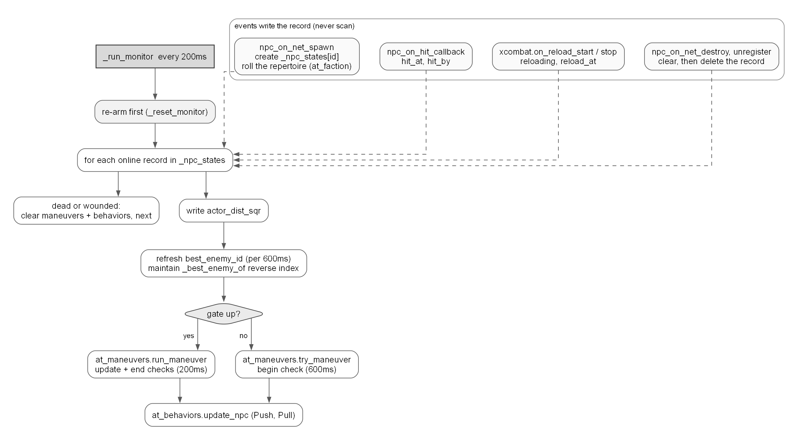
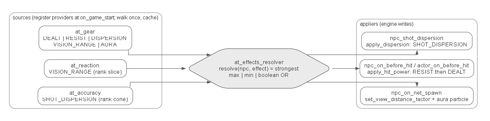
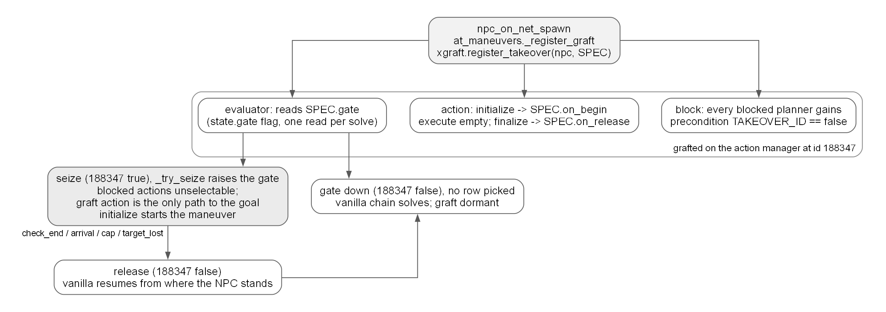
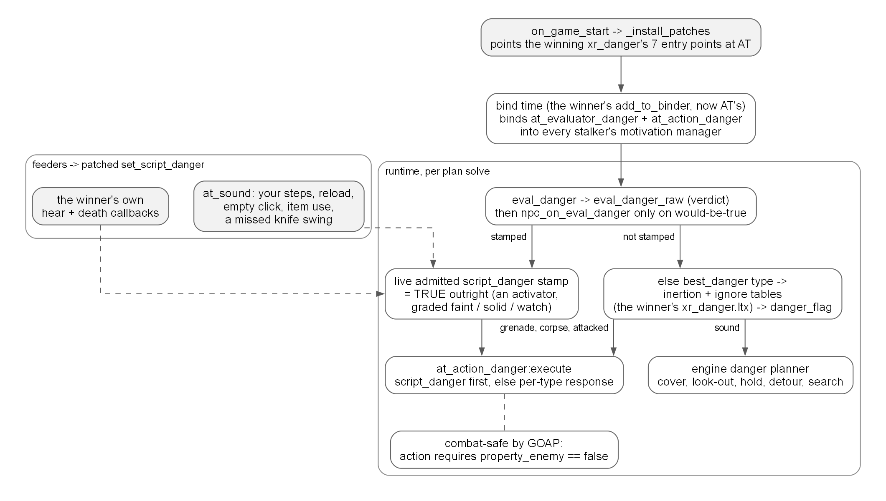

# AlifeTactics Architecture

## Summary

AlifeTactics is a combat AI layer for STALKER Anomaly, for stalkers and mutants. It composes with the installed combat brain, vanilla or a third-party overhaul, and ships no vanilla script file.
It acts on X-Ray in three ways:
- Takeover: Maneuvers borrow one stalker from the engine's GOAP planner for one committed move, then hand him back.
- Veto and answer: Commitment, Conduct, Sound and Danger answer the engine's questions or deny its switches, and the engine keeps driving.
- Value write: the rank curves, Gear and the mutant parameters write per-NPC numbers the engine reads.

Two drivers run it: `at_core._run_monitor` every 200ms for stalkers near the player, and the mutant beat every 600ms inside `monster_on_update`. Every other system runs on an engine event.
Every action follows one decision model: a premise finds an opening, Personality says whether the individual carries the move, and one Intelligence roll says whether he takes it now.
A takeover imposes and every other stalker write composes. A shared start budget bounds the stalker starts, and mutants pace by cooldowns and the after-hit hold.
It builds on xlibs, which owns every engine call that needs a guard, and on engine hooks merged into the demonized build.


## Glossary

- GOAP: goal-oriented action planning, the X-Ray stalker brain. A planner picks a chain of actions whose preconditions reach its goal.
- Premise: a named check of objective state that finds an opening, a `_check_<move>` or `check_need` function.
- Repertoire: the set of moves an individual carries, rolled once per record. It is Personality.
- Intelligence: one roll at the moment of decision, `(base + per-rank x rank) / 100`, capped.
- Panic: flee, with a separate check against 1 - Intelligence. A dull individual flees more. Its gate token is `inv_int`.
- Wild: a bounded spread of a mutant's numbers, with no roll.
- Participant: a stalker the systems act on, `at_faction.is_participant`, every community but zombied.
- Vulnerable: an enemy who cannot answer fire now, `at_core.is_enemy_vulnerable`.
- Record: the per-individual state, `_npc_states[id]` in `at_core` for a stalker, `rec` in `at_mutants` for a mutant.
- Takeover: a maneuver's hold on one stalker through the GOAP graft. Seize starts it and release ends it.
- `state.gate`: the takeover flag, the planner world property 188347, true while seized.
- Gate radius: `gate_radius_m` around the player, read by `at_core.is_in_gate`. Maneuvers, Push, Pull and the mutant beat run inside it.
- Block check: `_check_<action>_block`, the business gate, nil or a reason. `_can_<action>` is its engine-state part.
- Row filter: the table reads before a maneuver walk, then the Intelligence side. A fighting row needs the Intelligence check passed, and a panic row draws its inverse check last.
  The scope drops Counterflank in a fight with the player and every other row past the gate radius. The palette checks the row's weapon kinds against the stalker's weapon.
- Liquidate: Commitment's deferral, a stalker who keeps firing past the hold cap while his enemy stays vulnerable.
- Start: one begin of an action that spends from the start budget.
- Impose and compose: the two start tiers. Impose is a takeover, compose is a write on a stalker the engine still drives (Push, Pull, Liquidate).
- Stamp: a graded script danger entry, `xr_danger.set_script_danger`, that the danger scheme reacts to.
- Effect channel: a per-NPC value more than one source feeds, combined in `at_effects_resolver`.

## Decision model

- Personality: the repertoire, rolled once per record over the moves its kind can make.
  The chances come from `[<action>]` in `at_faction_config.ltx` for stalkers and `[personality_<move>]` in `at_mutants_config.ltx` for mutants.
- Intelligence: the stalker pair keys to his rank (Combat General), the mutant pair to the map's danger tier (Mutants General, `xlevel.get_danger_tier`).
- A stalker record is born at `npc_on_net_spawn` (`at_core._on_net_spawn` calls `at_faction.build_repertoire`), a mutant record at adoption (`at_mutants._build_repertoire`).
  A later encounter rolls again.

A decision moment takes one Intelligence roll, in one of two shapes:
- A selection filters, shuffles, then checks premises. The filter reads tables only: repertoire, MCM toggle, cooldown keys, and for stalkers the scope, weapon palette and loop guard.
  The survivors shuffle (`xmath.shuffle_back`, Fisher-Yates), the walk checks the premises of up to `candidates` rows (`[at_maneuvers]`, `[select]`), and the first that fires wins.
  The walks are `at_maneuvers._select_maneuver` and `at_mutants._select_move`.
- An independent opening checks the repertoire, then its premise, then rolls Intelligence: Push, Pull, the claw, the Liquidate deferral. A missed roll stamps the move's cooldown.

Lever shapes, by who owns the trigger:

```
shape              roll                                 members
per-opening        repertoire, then Intelligence        the maneuvers, Push, Pull, Liquidate, the mutant leaps, claw, backstrike, gravity throw, cloak
panic              repertoire, then 1 - Intelligence    flee, for stalkers and mutants
persistent trait   Intelligence then the faction [conduct] chance, cached  Conduct discipline, for the NPC's life, because the engine fires the behavior itself
wild               none, a bounded spread               the mutant ability numbers, the leap force, the steering gain
correctness        none                                 Commitment's switch denial, the danger scheme repairs, the targeting fixes
skill scaling      none, gated by is_participant        the accuracy, aim, vision and discipline curves
```

## Principles

- Compose, do not replace. A system attaches by a callback, a function patch, a DLTX overlay, a scheme patch or the takeover. A file override does not ship.
- Engine first. Where Lua cannot reach a C++ decision point, the hook goes into the demonized build first and the mod consumes it second.
  A hook is probed at load, and its feature goes inert with an INACTIVE line when the hook is absent. Hooks below lists each one.
- One decision model for stalkers and mutants.
- Policy here, mechanism in xlibs. An engine call that needs a guard, carries a hidden meaning or needs a probe goes through xcombat or xmonster (`stalker-code.md`, xlibs wrapper criteria).
  Where a guarded wrapper exists, the raw call is a defect.
- Performance first. Only correctness and base gameplay outrank it. The budget is `stalker-code.md`, Performance budget.
- Event-driven. Work runs on a scheduled time event or a discrete engine event. A throttle placed after the dispatch of a per-frame carrier is per-frame work.
- Feed the engine. AT writes engine memory and state, and the engine runs its own combat on what was written.

## Boundaries

```
xray-monolith (C++): the planners, CEnemyManager, the sound and visual memory, the monster FSM, the hooks AT consumes
  -> xlibs: xcombat (stalkers), xmonster (mutants), xgraft (the takeover), xttltable (sliding-window counters), xslice (one item per frame)
    -> AT substrate: at_core (records, loop, budget), at_faction, at_effects_resolver
      -> AT systems, one module per MCM page group
anomaly scripts (xr_danger, state_mgr, xr_eat_medkit, xr_weapon_jam, rx_ff): patched in place by Danger, Healing, Jamming, Maneuvers
```

- A system reads the substrate through the `at_core` publics and writes the engine through xlibs.
- A system owns its own per-NPC state. The record store owns the shared combat facts.
- Observability modules read records through public getters and write no gameplay state.

## Container: the MCM tree

The container level is the MCM tree in `at_mcm.script`, 1:1 in grouping, order and names. Each MCM page is one Component section below.


```
tab              page              module                  trigger
Combat           General           at_faction, at_core     the Intelligence pair; Hit reaction hold on the core loop
                 Maneuvers         at_maneuvers            the core loop
                 Commitment        at_commitment           the action-switch and cover re-pick vetoes
                 Conduct           at_conduct              the body-state and combat-distance asks
                 Behaviors         at_behaviors            the core loop
Effectiveness    Accuracy          at_accuracy             the shot dispersion callback
                 Crossfire         at_crossfire            npc_on_before_hit
                 Reaction          at_reaction             the spawn binds, the shot callback
                 Discipline        at_reaction             the spawn bind
                 Range             none                    planned
Perception       Sound             at_sound                the hear callback, on_enemy_eval, a 500ms pass
                 Vision            at_reaction             the spawn bind
                 Danger            at_danger               the xr_danger patch
Mechanics        Healing           at_healing              the xr_eat_medkit patch, a 200ms pass
                 Jamming           at_jam                  the misfire functor
                 Ammo              at_ammo                 a 5s pass
                 Attachments       at_attachments          npc_on_item_take, a 3s pass
                 Gear              at_gear                 resolver providers, the item callbacks
Effects          none              none                    planned
Mutants          General           at_mutants              monster_on_update, the 600ms beat
                 Power             at_mutants              off in the release (MUT_POWER_ENABLED)
                 one per species   at_mutants              the same beat
Fixes                              the owning systems      locked toggles
Development                        at_debug, at_world_trace, at_hud, at_test
```

The substrate has no MCM page: the record store, the faction gates, the effects resolver, the xcombat boundary and the GOAP graft.

## Runtime

```
at_core._run_monitor every 200ms: re-arm -> _update_hold -> per stalker record: dead or wounded -> clear, next
                                  -> actor_dist_sqr -> best_enemy refresh (600ms)
                                  -> at_maneuvers.try_maneuver (600ms) or at_maneuvers.run_maneuver (200ms) -> at_behaviors.update_npc
at_mutants._on_mob_update per binder tick (100ms near to 625ms far): contact lane -> adopt -> beat, once per 600ms per mutant
at_ammo._run_monitor every 5s: AP box decay
at_attachments._run_monitor every 3s: pending stalkers -> xslice, one per frame -> mount
at_healing._run_monitor every 200ms: limp pose and its drop checks
at_sound._run_pass every 500ms: accumulated step radius -> stamp hostiles inside it
at_world_trace, at_hud: registered only while their Development toggle is on
```



- `_run_monitor` registers from `actor_on_first_update` and re-arms after a save load, because time events do not survive a load. It re-arms first, so an error costs a pass, not the loop.
- It runs while Combat, Push, Pull or Hit reaction hold is enabled (`at_core._apply_enabled`).
- `monster_on_update` is a scheduler-cadence callback, not a render frame. A cadence gate inside it is a legitimate carrier.

Lifecycle of a stalker record:
- Born at `npc_on_net_spawn` with its repertoire. The spawn binds of Reaction, Vision, Discipline and Gear apply at the same moment.
- Death or a wound clears the maneuver, the Push and Pull windows and the hit hold in the next pass.
- Deleted in one teardown on `npc_on_net_destroy` and `server_entity_on_unregister`.

A mutant record is adopted on its first update in reach and drops after `STALE_MS` idle, then is adopted again.

## Substrate

### Combat record store

Does: holds one record per tracked stalker, the reverse threat index and the start budget (`at_core.script`).
Changes: nothing in the world.
Stops: the record dies in the teardown above.

```
_npc_states[id] field           writer                    meaning
id, ran_at{}, repertoire        at_core (spawn)           identity, the per-check clocks, the Personality set
hit_at, hit_by                  at_core (hit)             the last landed hit: time and shooter id
reloading, reload_at            at_core (reload edges)    the reload window, from the engine reload events
actor_dist_sqr                  the loop                  squared distance to the player
best_enemy_id, best_enemy_at    the loop                  the engine's selection, refreshed every 600ms
gate, maneuver, dest, enemy_id  at_maneuvers              the takeover flag, open row, destination, committed target
window_starts                   at_maneuvers (start)      per-row starts inside window_limit_sec, an xttltable counter
push_*, pull*                   at_behaviors              the open press and pull windows
```

- `_best_enemy_of` maps a target id to the stalkers holding it as best enemy. The loop writes both directions. A reader takes candidates from `get_threats` and checks its predicates live.
- The start budget `_starts` is a sliding-window counter (xttltable) in four buckets, tier (impose, compose) x target (player, NPC).
  `[at_core]` in `at_maneuvers_config.ltx` sets it. Only a start spends.
- The budget publics are `check_start`, `add_start`, `get_bucket` and `can_start`. The record publics are `get_combat_record`, `get_combat_records`, `get_best_enemy` and `get_threats`.
  The predicates are `has_recent_hit`, `is_enemy_back_turned`, `is_enemy_vulnerable`, `is_in_gate` and `check_chance`.

`is_enemy_vulnerable` answers whether an enemy can return fire now:
- Any enemy: a back turned on the asker.
- The player: the weapon block terms (`xcombat.get_block_reason`: unarmed, reloading, empty magazine), sprinting, climbing.
- A stalker: the block terms, a playing animation (`xcombat.is_body_busy`).
- A mutant: not covered.

### Faction gates

Does: rolls a stalker's repertoire from his faction's chances, and owns the stalker Intelligence roll (`at_faction.script`).
Changes: nothing in the world.
Stops: a zombied stalker takes part in nothing. `is_participant` is the universal filter.

```
is_participant(npc)              community ~= zombied
build_repertoire(npc)            one roll per action (counterflank, reload_cover, flee, retreat, kite, pickoff, push, pull, liquidate)
                                 against [<action>] for his faction, else default, else 1.0
check_personality(npc, action)   the per-call roll, for the Conduct trait only
check_intelligence(npc)          one roll against min((int_base + int_rank_pct * rank index) / 100, [caps] intelligence)
```

### Effects resolver

Does: combines each effect channel and owns its engine write. It is a registry of Strategy providers (`at_effects_resolver.script`).
Changes: `set_view_distance_factor` and the aura at spawn, hit power on before-hit, dispersion on the shot callback.
Stops: a single-source value stays in its owning module.



```
effect           combine   sources
DAMAGE_DEALT     max       at_gear: electro, quest-special
DAMAGE_RESIST    min       at_gear: gravi, ballistic plates, the chemical interim
SHOT_DISPERSION  min       at_accuracy: the rank curve; at_gear: thermal
VISION_RANGE     max       at_reaction: the rank curve; at_gear: binoculars by day, night vision by night
AURA             OR        at_gear: any artefact class
```

- `register(effect, fn)` adds a provider, `resolve(npc, effect)` combines, `apply_binds(npc)` re-applies the spawn-bound effects after a source invalidates its cache.
- A provider walks the NPC on its first call and caches in its module. The `net_spawn` applier is the first caller, so the walk stays out of the hit and shot callbacks.
- The aura particle has no stop path, because `stop_particles` trips the engine bone assert on a non-renderable bone. It dies with the game object.

### xcombat boundary

Does: issues the combat commands and reads that need a guard, a meaning or a probe, one primitive per call.
Changes: weapon state, aim, movement, cover search, the cover reservation, the takeover.
Stops: it is stateless. AT owns when, whom and which maneuver. The primitive surface is in the xlibs architecture.

### GOAP graft

Does: gives the takeover a control point in the stalker's GOAP planner. While `state.gate` is up, the planner reaches its goal only through AT's action.
Changes: an evaluator, an action and a block precondition on the motivation manager, once his logic is ready.
Stops: a companion is excluded while `combat_ignore_companions` is on.



```
npc_on_net_spawn -> at_maneuvers._register_graft -> xgraft.register_takeover(npc, SPEC), deferred until the logic is ready
  SPEC.gate -> the evaluator reads state.gate; SPEC.on_begin -> _start_maneuver; SPEC.on_release -> _on_release
seize     188347 true    apply_takeover_block makes the blocked actions unselectable, initialize starts the maneuver
release   188347 false   vanilla resumes from where the stalker stands
```

- `initialize` clears animations, sets path, direction and danger mental state, registers in combat, then calls `SPEC.on_begin`.
- `apply_takeover_block` blocks the vanilla combat, danger and cover planners and the monolith, zombied, camper and facer sub-schemes (`xgraft.get_blocked_planners`).
  It runs on each seize, per NPC, because a world property added twice to one action throws (`condition_state_inline.h`, `CConditionState::add_condition`).
- 188347 sits off the vanilla property id range.

## Rules and invariants

- A maneuver clears the need that started it. A need the maneuver cannot clear picks the same row again, and the stalker loops on it. The `need_cleared=` field of the `[CMB] end` trace checks it.
- Gates are named, not inline: `_can_<action>(obj)` for engine state, `_check_<action>_block(...)` for the business gate, `_try_<action>` for one block check then the act.
  Intelligence is a named roll, `at_faction.check_intelligence` and `_check_intelligence` in `at_mutants`. Repertoire and cooldowns are filtered before a `_try_` runs.
- Each `_npc_states` field has one writer.
- A seized stalker proposes no switch, and neither Commitment, Conduct nor Behaviors reaches him. Maneuvers take precedence.
- Every hold has its release. A toggle-off releases what its system holds live.
- Debug is free when off. A trace gates on `at_debug.is_on()`, an integer compare, and the timers are null objects.
- A vanilla or xray fix appears on three surfaces: the readme under Fixes, the changelog as a Fixed vanilla bug line, the MCM Fixes tab.
- The MCM defaults in `at_mcm.script` are the only copy of the rank curves.
- `at_<system>.script` holds the logic and `at_<system>_config.ltx` the numbers. A `_config.script` exists where LTX cannot hold the shape, as the maneuver catalog references methods.

## Combat

The scope of Maneuvers, Push and Pull:
- Inside the gate radius.
- Against a human target, the player or a stalker, and never for a zombied stalker.
- A wounded man (`xcreature.is_wounded`) is neither an actor nor a target until he stands. The vanilla finisher handles him.
- Fights against mutants and fights past the gate radius stay vanilla.

### General

Does: holds the stalker Intelligence pair, `int_base` and `int_rank_pct`, capped at `[caps] intelligence` in `at_faction_config.ltx`.
Changes: the chance `at_faction.check_intelligence` rolls against.
Stops: nothing else reads the pair.

The page also holds Hit reaction hold (`combat_hit_hold`), a fix for every tracked stalker, maneuvering or not. Its code sits in `at_maneuvers.script` on the core loop.
- `npc_on_hit_callback -> _on_hit` raises `xcombat.set_movement_hold` on a staggering, flinching or standing stalker. The engine mover keeps him in place with his path intact.
- `_update_hold` runs first in every pass and releases the hold once the hit reaction ends. The option sweep releases every hold when the toggle goes off.

### Maneuvers

Does: seizes one stalker through the GOAP graft for one committed, time-boxed move, then hands him back.
The catalog rows are Strategies: each supplies `check_need`, `find_destination`, `update` and `check_end` (`at_maneuvers_config.script`).
Changes: destination, fire intent, posture and movement, set once and re-applied on the update check.
Stops: one open maneuver per stalker, bounded by the impose budget, ended on arrival, the cap or a broken premise, cleared on a wound, death and despawn.
In an emission or a psi storm (`xlevel.is_surge()`) with Emission override on (`combat_emission_override`), no maneuver starts and the open one ends with reason `surge`.
Maneuvers is the only AT system that writes a destination (`xcombat.set_destination`). The hit hold keeps running, because `_update_hold()` runs before the begin and end checks.

```
begin (try_maneuver -> _try_begin_maneuver):
  fighting: a live best enemy or a recent hit; a wounded enemy counts as none; the enemy is the player or a stalker
  _check_seize_block: not a companion, the graft registered, armed, outside smart cover, no playing animation, budget left
  _select_maneuver: the Intelligence chance once; the fighting rows need its check passed, flee draws 1 - Intelligence
    _filter_rows: scope -> toggle -> repertoire -> palette -> loop guard -> Intelligence side -> shuffle -> check_need -> find_destination
  _check_repeat_limit -> _try_seize: spend a start, apply_takeover_block, raise the gate, stamp row, destination, committed target
update (run_maneuver -> _update_maneuver): re-apply the row's state; skip while reloading or in a hit reaction
end    (run_maneuver -> _try_end_maneuver): check_end, arrival or the cap; a lost target ends it
```

```
maneuver      need                                            destination                          fire; move     ends on
counterflank  the player close, the committed target farther  holds, aims at the player            FIRE; STILL    the cap
reload_cover  reloading, a watcher has him in sight           nearest hiding cover                 READY; RUN     arrival, reload done
flee          hurt, a threat in reach, the last man,          a far friendly base, away from       STOW; RUN      arrival or the cap
              not under fire; on its 1 - Intelligence check   the threat
retreat       hurt, his spot exposed to a threat in reach     the best cover behind him            FIRE; WALK     arrival or the cap
kite          a threat inside his weapon minimum              a clear lane back                    FIRE; WALK     arrival or the cap
pickoff       stalled past the enemy's effective range        holds                                single; STILL  the cap or premise broken
```

One maneuver end to end, `reload_cover`:

```
xcombat.on_reload_start -> at_core._on_reload_start: state.reloading, state.reload_at
core loop -> try_maneuver -> _try_begin_maneuver -> _check_seize_block -> _select_maneuver, an Intelligence pass
  _filter_rows keeps the row -> _check_reloading_watched: a fresh reload, the closest threat sees him (xcombat.is_in_sight) -> the staged threat
  _find_reload_cover: xcombat.is_reloading -> xcombat.get_quick_cover away from the staged threat
_try_seize: an impose start -> apply_takeover_block -> state.gate true -> the graft's initialize -> _start_maneuver
run_maneuver -> _update_maneuver: apply_state re-applies READY, STAND, RUN toward the cover
run_maneuver -> _try_end_maneuver: arrival, or _check_end_reload_cover once xcombat.on_reload_stop clears state.reloading, or the cap
  -> _on_release -> state.gate false, and vanilla resumes where he stands
```

- Counterflank applies to a stalker fighting someone else. The other rows apply per faction through the repertoire.
- Retreat clears "hurt and exposed" on arrival, and reload cover clears "reloading and watched".
- Retreat's exposure test is `xcombat.is_concealed` at the floor `xcombat.get_best_cover` picks by. Without concealed cover in reach, retreat takes a clear lane back (`xcombat.find_free_lane`).
- The committed target is the staged id. Update and end resolve it and do not read best_enemy again. A dead or despawned target ends the maneuver.
- Fire intent goes through `xcombat.set_combat`. A reloading weapon degrades it to READY, because a fire goal mid-reload cancels the engine reload.
- The burst shape patches `state_mgr_weapon.get_queue_params` (`_compute_queue_params`): size and pause rolled per query inside the engine's per-weapon band, times the Discipline factors.
  A stalker outside a maneuver passes through unchanged.
- The stuck guard (`_check_repeat_limit`) refuses the same situation picked again in place. The loop guard (`_check_window_limit`) refuses a row a stalker started too often, wherever he stands.

### Commitment

Does: holds a stalker on a winning fire action. It is a veto on two engine hooks.
Changes: it answers deny on a proposed action switch or cover re-pick.
Stops: it only denies. A transition that does not leave a fire action passes.

```
npc_on_combat_action_switch (xcombat.on_action_switch) -> _on_action_switch: flags.allow = false (at_commitment.script)
  kill_enemy, kill_if_not_visible -> take_cover, get_ready_to_kill : held while he sees the enemy, the lane is clear (can_kill_member), fire_make_sense
  detour_enemy -> take_cover                                       : held while blind, released on sight
npc_on_best_cover_repick (xcombat.on_cover_repick) -> _on_cover_repick: denies the swap that clears InCover
```

- `kill_enemy` requires `InCover` (`stalker_combat_planner.cpp`, `CStalkerCombatPlanner::add_actions`), and a re-pick clears it before the exit is proposed.
  Holding the cover keeps the exit unselectable.
- `commitment_hold_s` caps one continuous refusal. An allowed switch resets it.
- At the cap, Liquidate defers while `at_core.is_enemy_vulnerable` holds (`_try_extend_hold`). It needs liquidate in the repertoire.
  The first deferral rolls Intelligence and spends a compose start. A failed roll or a dry bucket ends the hold.

### Conduct

Does: cover posture and weapon spacing on stalkers the engine drives. It is an Observer on two engine asks that answers one value.
Changes: the body-state answer, and the combat-distance band.
Stops: a seized stalker reaches neither callback.

```
npc_on_combat_set_body_state -> _on_combat_body_state (at_conduct.script)
  hold_position only; rifles and snipers, experienced and up, the discipline roll; stand at close range
  the decision held for decide_ms: crouch when the crouch-eye shot ray is clear (xcombat.has_shot_obstacle), else stand
npc_on_get_min/max_combat_dist (xcombat.on_get_min/max_combat_dist) -> the engine's band, scaled behind the discipline roll
  SMG maximum lowered, sniper minimum raised by rank; the Push cap and the Pull band apply here as overlays
```

- A handler scales the base the engine hands it and keeps its weapon-type meaning.
- The posture decision is held because the engine asks several times a second and the crouch line flips.

### Behaviors

Does: Push presses a stalker whose target cannot answer. Pull pulls back a stalker in his own weak moment while his target stays strong.
Changes: Push raises the fire queue and tightens the cover maximum. Pull raises the cover minimum.
Stops: each write reverts within a pass when its cause clears. A seized stalker does not press or pull.

```
at_core loop -> at_behaviors.update_npc per record
Push (_update_push_npc): in the gate radius, a human target, push in the repertoire, the press cooldown spent, a participant
  cause: is_enemy_vulnerable (push_reload) or the target weak with hysteresis (push_finisher)
  check the compose bucket -> Intelligence (a miss stamps the press cooldown) -> writes -> the first write spends the start
  FIRE: the queue raised by range band; BAND: a closer cover maximum on an advantage (bleeding, back turned, himself healthy); capped at push_window_max_ms
Pull (_try_open_pull, _update_pull_npc): pull in the repertoire, reloading or hurt after a recent hit, the target strong
  check the compose bucket -> Intelligence (a miss stamps the pull cooldown) -> spend the start -> at_conduct.set_pull_band, held a minimum window
```

- Pull outranks Push. The Conduct handlers apply the pull overlay after the push cap.
- A write happens on a transition against the per-NPC mirrors, and clears on cause end, toggle-off, seize, a wound, death, despawn and unregister.

## Effectiveness

Effectiveness is per-NPC skill on fire and perception the engine drives, whatever drives the stalker.
A rank curve is a base and percent-per-rank pair over the 8 ranks: value = base * (1 + pct% * rank index), floored at 0.01.
Reaction, Vision and Discipline share `at_reaction.script`. `set_aim_params` writes aim, lock and lead in one engine call.

### Accuracy

Does: gives NPC dispersion a per-rank curve. It is a SHOT_DISPERSION Strategy provider.
Changes: the flat curve through the resolver, the moving-fire curve on `npc_shot_dispersion` while walking or running.
Stops: a page toggle off passes the shot through.

The engine rank knob does not work on Anomaly. `CAI_Stalker::Rank` clamps to 0-100 (`ai_stalker.cpp`) while Anomaly ranks run to 26999.
Each NPC therefore gets the shared constant `m_fRankDisperison` (`ai_stalker_fire.cpp`).

### Crossfire

Does: scales damage between stalkers who are not enemies. It is an interceptor on the before-hit callback.
Changes: `shit.power` x `crossfire_factor` on `npc_on_before_hit`, without a throttle.
Stops: enemies (`xcreature.is_enemy`) take full damage, and the player as shooter is excluded. It keys on the relation, not the community.

### Reaction

Does: aim speed, tracking lock and target lead per rank, plus the two always-on targeting fixes.
Changes: a bind at spawn, and a lead recompute on the shot callback.
Stops: aim stays under the max aim angle and above the global baseline. The player's difficulty holds.

```
npc_on_net_spawn -> apply (at_reaction.script):
  set_hit_redirect             the last attacker's selection cost drops, falling to 0 with distance (sticky targeting)
  set_visible_enemy_bias       the player pull, selection_actor_bias on the Danger page (player bias)
  set_aim_params               the aim and lock curves; -1 where the global is already stickier
npc_shot_dispersion -> _on_shot_lead, once per second per NPC: predict = clamp(range / bullet_speed * lead factor)
  bullet_speed = the section's bullet_speed x the loaded round's k_bullet_speed (sight_action.cpp, predict_object_position)
```

- The targeting binds are vanilla fixes on the Fixes tab, outside the page toggles.
- `fire_make_sense` still requires line of sight.

### Discipline

Does: burst size and cadence per rank. The defaults are a near-flat band.
Changes: `set_fire_queue_scale` at spawn, and `get_queue_scales(npc)`, the owner of the rank tables, read by maneuver fire and the Push restore.
Stops: the interval has a floor, and the defaults keep each rank's rounds per minute at or above vanilla.

A state_mgr fire state reaches the object handler with explicit parameters. Maneuver fire multiplies the same factors through `get_queue_scales`.

### Range

A placeholder page with no code. Its subject is the engine's fixed NPC fire range cap.

## Perception

Sound and Vision detect. Danger owns the reaction scheme they stamp into.

### Sound

Does: opens a stalker's sound memory to the player before contact, and stamps the danger scheme for player noise the memory drops.
It also turns a standing stalker toward a creature he hears, and stamps the target of a missed knife swing.
Changes: the `on_enemy_eval` answer, the `xr_danger.set_script_danger` stamps, a look target.
Stops: crouched movement is silent. A neutral hearer gets neither the answer nor a stamp from player noise.
The same holds for movement and handling noise at a hostile hearer that `xr_combat_ignore.is_enemy` excuses, in a peace zone or under a bribe.
A creature sound stays out of the danger scheme. A heard shot stays with the engine.

```
npc_on_hear_callback -> _on_hear (at_sound.script), a hostile hearer, a player source:
  _set_store_window: power x type factor >= the install's keep floor -> _store_open_at[id] = now
  reload, empty, item-use within their radius -> a stamp at the sound position
on_enemy_eval -> _on_enemy_eval: a fresh window, the player as enemy -> flags.override, flags.result = true
  asked inside the store: CSoundMemoryManager::add -> CEnemyManager::useful -> xr_combat_ignore.is_enemy
actor_on_footstep, actor_on_land -> noise radius = base x stance (crouch 0) x surface x MCM multiplier x hearing scale
_run_pass (500ms) -> cut by rain -> stamp each hostile in db.OnlineStalkers inside the radius
creature sound (a mutant, or a hostile stalker) -> _try_glance: standing, out of combat -> a same-state look refresh
actor_on_hud_animation_mark, a knife swing -> _find_swing_target, the nearest stalker in front -> a short event
  a connecting hit reaches npc_on_before_hit first and clears it; a miss stamps watch
```

- On the multi-thread exes the store asks `is_enemy` before keeping a sound, and the answer is no without a recent memory of the player. The window answer fills that gap.
  The chain is in `doc/library/xray/internals/npc-hearing.md`.
- The window yields to a subscriber that already set the flags, to the hearer's combat-ignore overrides, and to bribe peace.
- The hear callback runs before the store (`CSoundMemoryManager::feel_sound_new`). An empty window table makes the idle cost one check.
- A walk is below the keep floor always, and a run past a short range. The stamp channel covers those steps in script, without writing the engine's sound memory.
- Stealth is a vision system. Sound does not touch vision, seen memory or the sight test.
- Neutral gunfire alert (`danger_neutral_gunfire`) governs the stamp vanilla puts on a stalker whose feet the player's bullet strikes (`xr_danger.npc_on_hear_callback`).
  The engine drops a neutral's heard shot in the store (`CSoundMemoryManager::add`). `_has_admitted_stamp` in `at_danger.script` admits the stamp for a neutral or friend while the toggle is on.
- The knife stamp uses `threat_na`, because `threat_danger`'s `bloodsucker_search` animation owns the look. A stalker on the camper job does not reach the action (`xr_camper.script`).

### Vision

Does: acquisition speed and view range per rank.
Changes: `set_vision_speed` at spawn, the step of the detection accumulator (`visual_memory_manager.cpp`, `CVisualMemoryManager::update`), and a VISION_RANGE provider.
Stops: the formula has no transparency term, so speed does not see through cover. Speed starts at vanilla for a novice and rises with rank.

### Danger

Does: layers fixes and two improvements onto the installed xr_danger, so the reaction matches what a stalker perceives. It is a function patch over 7 entry points.
Changes: the winning xr_danger's entry points at `on_game_start`, and AT's evaluators and action on each stalker.
Stops: it ships no xr_danger.script and does not contest the MO2 slot. The winner's hear and death feeders keep running.



```
on_game_start -> _install_patches (at_danger.script): setup_generic_scheme, add_to_binder, configure_actions, reset_generic_scheme,
  get_danger_time, set_script_danger, has_danger
add_to_binder -> at_evaluator_danger + at_action_danger on the motivation manager
plan solve -> eval_danger -> eval_danger_raw, then npc_on_eval_danger on a would-be-true verdict (a veto clears the inertion latch)
  a live admitted script_danger stamp -> true
  else the best danger -> the inertion and ignore tables of the winner's xr_danger.ltx -> danger_flag
at_evaluator_check_danger: attacked, corpse, grenade to the script; sound dangers stay with the engine planner
at_action_danger:execute -> the stamp first, else grenade, corpse or attacked; requires property_enemy == false
```

Stamp grades, weakest first:
- faint: a standing stalker turns weapon-ready toward the position. A walking one ignores it.
- solid: he walks over (raid).
- watch: the knife grade, `threat_na` looking at the source. It ranks with solid.
- rush: he runs. Companions only.

- An unexpired stronger stamp survives a weaker one.
- The grades above faint aim with a look direction (`_get_look_target`), not a position.
  The state manager counts a position as reached while the sight carries an animpoint direction (`state_mgr_direction.script`).
- The active reaction runs one stage-2 give-up band, then a standing watch until the config inertion decays.
- `_is_squad_engaged` skips it while a squadmate holds a live enemy.
- The install adds the monolith sub-scheme's four actions to `state_mgr.combat_action_ids`, and patches three rx_ff members: the friendly-fire freeze, the over-hold and the blocked-shot lane test.
- Distant hits (`danger_hit_bypass`) answers a hit danger past the ignore distance, after the relation, alive and combat-ignore checks.
- Emission override (`danger_emission_override`): in an emission or a psi storm, `_has_admitted_stamp` returns false and Distant hits is off.
  A stamp then counts only beside a real danger, as vanilla reads it (`xr_danger.script:262-315,693-701`), and no stamp walks a sheltered stalker out.
  Vanilla's hit and impact stamps feed it (`:96-133`).
- Attempted murder (`danger_knife_miss`) is the Sound knife stamp, without a relation check. A neutral or friend takes the Neutral gunfire admission.

The DLTX `mod_xr_danger_at.ltx` deletes the dead perceive keys of the `EDangerPerceiveType` name collision (`danger_object.h`). Detection distances come from the winning xr_danger.ltx.

## Mechanics

### Healing

Does: active first aid: a heal-rate multiplier, a pause while fighting, a per-rank medkit charge, a limp and heal gesture. It is a Decorator over three xr_eat_medkit members.
Changes: `heal_hp`, `heal_bleed` and `consume_medkit` at `on_game_start`, the charge at spawn, the limp pose on a 200ms monitor.
Stops: bleed staunching stays vanilla. The animations play only near the player.

```
on_game_start -> _register_heal_patch (at_healing.script): heal_hp, heal_bleed, consume_medkit
  _update_heal_hp: change_health x the multiplier; ResetTimeEvent while engaged (a live enemy, the weapon out or the enemy at contact range)
zzz_at_healing_patch: unregisters vanilla xr_eat_medkit.on_register (the save-load charge re-roll)
mod_xr_eat_medkit_at.ltx: the medkit and bandage lists vanilla [plugin] omits
_run_monitor (200ms): the limp pose, dropped when its gait stops matching
```

A queued script animation suspends the engine's animation selection (`CStalkerAnimationManager::update`, `stalker_animation_manager_update.cpp`).
The end of a heal chain clears `db.storage[id].healing_active`, the lock a rewritten medkit scheme sets in `consume_medkit` and clears only in its own `heal_hp` and `heal_bleed`, which ours replace.

### Jamming

Does: drops the misfire roll the modded exes inject for NPCs. It is a Decorator over the misfire functor.
Changes: `xr_weapon_jam.GetConditionMisfireProbability` returns `base_value`, the wear misfire `Weapon.cpp` computes, while enabled.
Stops: off, it forwards to the original. The player's weapon is untouched.

### Ammo

Does: a veteran-and-up stalker fires AP from the loose ammo he carries, with one box decay per fight.
Changes: `wpn:set_ammo_type`, and an inventory box delete.
Stops: inert while `g_ai_unlimited_ammo` is 0, because the engine then spends real rounds.

```
_run_monitor (5s) -> update_npc (at_ammo.script): rank >= min_ap_rank, a live weapon, an AP class it takes
  in combat: hold m_ammoType on the AP index while AP is carried
  at peace (no best enemy for peace_debounce_ms): roll the decay, release one AP box, type 0 when empty
```

The inventory is the budget. A deleted box is permanent, because `try_advance_ammo` (`object_actions.cpp`) refills surviving boxes only. Decay is per fight because no NPC fire callback exists.

### Attachments

Does: a stalker mounts a loose scope, silencer or grenade launcher that fits his pistol or rifle, at the next quiet moment.
Changes: the gun's addon flag, or for a scope on an Anomaly base gun, a swap to its scoped variant with a new id.
Stops: it waits out a fight, a busy body and smart cover. It skips a gun the player or a quest claims, and story, named and story-squad stalkers.
A gift the player hands a companion stays as given (`axr_companions.script`).

```
npc_on_item_take -> an attachment marks the stalker pending (also with the toggle off)
_run_monitor (3s) -> snapshot the pending set -> xslice, one stalker per frame (at_attachments.script)
_run_slice_item -> _try_mount: _check_mount_block (toggle, participant, xcreature.is_unscriptable_se, no best enemy, _can_mount)
  combat, busy, smart cover -> stays pending; other blocks -> dropped
  the first loose attachment_slot_2 or _3 item that fits, pistol first -> xinventory.try_add_attachment; one mount per stalker per pass
```

- The mount runs outside the take callback. The engine attach checks no item state, and the item's destroy reaches the client a frame later.
  A mount in the callback could put vanilla's item on a second gun.
- One mount per pass keeps a second swap off a gun still spawning (`CLevel::ProcessGameEvents`, the spawn antifreeze, `Level.cpp`).
- The batch walks a snapshot array. The cleanup handlers clear only a stalker already pending, since a nil store to a missing key inserts it (`lj_meta.c`).

The fight effects are the engine's, and AT writes none. A scope tightens a still, aiming stalker's cone (`ai_stalker_fire.cpp`) and keeps the base gun's range (`Weapon.cpp`).
A silencer shortens the range other NPCs hear him at (`doc/library/anomaly/internals/sound-source-and-emitter.md`). A grenade launcher is visual.

### Gear

Does: gives an artefact one effect channel by its anomaly class, scaled by its tier. Its providers are Strategies on the resolver.
Changes: five resolver providers, plus the passive regen bind.
Stops: one artefact has a capped strength, and the strongest source wins.

```
on_game_start: register DAMAGE_DEALT, DAMAGE_RESIST, SHOT_DISPERSION, VISION_RANGE, AURA providers (at_gear.script)
first resolve per NPC: one inventory walk, the strongest strength per effect, cached
npc_on_item_take, npc_on_item_drop -> re-resolve a cached record
npc_on_net_spawn -> xcombat.set_health_restore_boost for the chemical strength
```

Detection is by section name, from the class lists in `at_gear_config.ltx`. Optics read day or night at the provider.

## Effects

A placeholder page with no code. Its subject is player-facing combat feedback such as concussion.

## Mutants

The mutant module runs the decision model without a takeover. The engine FSM stays the only mover. AT varies values at adoption and commands moves the engine validates.

### General

Does: adopts each online mutant, rolls its repertoire and leap numbers, and runs the decision model once per 600ms beat.
Changes: per-object ability parameters at adoption, as multipliers over the install's LTX values. In a fight, single invokes and proposal windows.
Stops: a move fires only inside its species envelope (`[moves]`). A companion mutant is left alone while `combat_ignore_companions` is on.
On toggle-off it releases what it owns live: a gravi force, a cloak, a steering gain, an armed backstrike.

```
monster_on_update -> at_mutants._on_mob_update
  each update -> contact lane: leap outcome, steering restore, claw
  adopt: species, map tier, [moves], repertoire, leap force, lead gain, Closing reach, jump auto-aim basis, gravi band, jump_delay, Wild offsets
  beat (600ms, _update_mutant): upkeep -> distance and motion sample -> held window (flee, gravity) skips -> is_in_gate -> Intelligence
    _filter_moves (repertoire, toggle, cooldowns, then a pass for the offensive moves and 1 - Intelligence for flee)
      -> shuffle -> up to candidates: leaps / gravity / cloak / backstrike / flee, the first fire wins
monster_on_combat_action -> proposes the run-away substate while a flee window holds
before-hit callbacks: damage dealt (shit.draftsman) and taken (monster_on_before_hit); a 1.0 track skips the write
```

The General page holds `mut_int_base`, `mut_int_rank_pct` and `mut_wild`.
- Intelligence: (base + per-rank x map tier) / 100, capped at `[intelligence] cap`.
- Personality: `[personality_<move>]` per species, rolled into the repertoire at adoption. A species favours one or two leaps and dislikes others, and every row is above 0.
  The tables follow the lethality ladder in the Personality header of `at_mutants_config.ltx`. Burer, controller, bloodsucker and poltergeist sit off the ladder.
- Wild: 0 identical, 100 the widest spread. It varies a standalone ability number by up to `[wild] ability_pct`, the jump force `CControlJump` fits its glide to, and the live steering gain.
  It leaves alone the values a capture-start gate, a path builder or a prepare trace reads: the jump distances, `jump_build_line_distance`, `Run_Attack_Dist`.

Pacing:
- `[cooldown]` holds one row in ms per key, kept per mutant in `rec.ready_at` (`_check_cooldown`, `_add_cooldown`). A key without a row does not cool down.
- A move waits on its own key and the shared `any_move` row. `_check_ready` names the blocking key, and `_add_fired` stamps both. The claw stamps on each roll.
- The gravity relay stamps the same key on an engine-fired throw.
- The after-hit hold: when our offensive move lands on the player within a short window of its fire, no mutant starts an offensive move on him for `[caps] after_hit_ms`.
  `_on_actor_before_hit` sets it and `_check_start` reads it. The offensive moves are the leaps, claw, backstrike and gravity.
  The creature's natural attacks, flee, cloak and moves against NPCs neither start nor wait on it. Any hit inside the window counts as the move landing.
- The jump rest: after any jump, ours too, the engine holds the creature's next jump for its `jump_delay` from the glide start.
  `CControlJump::on_event` sets the rest, and `CControlJump::can_jump` checks it (`control_jump.cpp`).
  `[jump_delay]` writes the chimera and lurker values at adoption, and other species keep the install's value.
  Our leaps and claw obey the same rest on both engine lines. The release line never checks it for a script jump and PR #799 does,
  so the non-aggressive `can_jump` mirror in `xmonster` refuses `rest` from the last landing the contact lane saw (`rec.landed_at`), which ends after the engine's rest.
  A creature jump shorter than one update can pass unseen. The PR line then refuses our next leap inside the rest, and the release line launches it.

### Species pages

A species page lists the moves the mod drives for that species, in up to three sections in this order:
- NEW MOVES, attacks vanilla does not fire for the species: the seven leaps, claw, backstrike, flee.
- MANAGED MOVES, the creature's attacks this mod times: the gravity throw, the cloak.
- INFLUENCED MOVES, abilities whose numbers Wild spreads at spawn: gravity numbers, telekinesis, psi tube, stamina, aura, detection.

The pages are chimera, bloodsucker, burer, controller, poltergeist, dog, boar, snork, pseudodog, gigant, cat, flesh, fracture, karlik, tushkano.
`[pages]` folds a subclass into its base page: lurker under chimera, psysucker under bloodsucker, psy_dog under pseudodog.

The moves:
- The leap family: seven handlers, each with its own premise, Personality row and cooldown row, sharing the launch path and one sight gate.
  - A leap is the species' jump through `xmonster.try_monster_jump`. Its damage is the jump's hit test (`CControlJump::hit_test`).
  - High, Hunting and Catching keep the species crouch (the `LAUNCH` table). The others set `ePrepareSkip`.
  - The chimera class, shared by the lurker (`SM_CHIMS`), loads no prepare motion (`CChimera::reinit` -> `load_jump_data`, `chimera.cpp`), so its loader sets `ePrepareSkip`.
    A wind-up request clears that mark (`CControlManagerCustom::script_try_jump`), and `CControlJump::start_jump` then glides without stopping the path and movement.
    `NO_CROUCH` launches the class instantly. Its rear-up lives in its attack state, not the jump.
  - The force is rolled once at adoption: `jump_factor` or `[leap] basis`, times a Wild band.
  - Inside `[leap] min_m` only High leap and the Closing leap toward a perch fire. The claw owns that range.
  - High leap: the enemy is perched (`_is_enemy_perched`), above the mutant inside its jump reach, standing higher or off the navmesh (`[premises]`).
  - Punishing leap: the enemy aims at the mutant (`xcombat.is_enemy_watching`, `[threat] aim_cone_deg`) or is vulnerable.
  - Hunting and Feral leap: the enemy moved since the last beat (`[motion] move_min_m`). They steer in flight through the `set_monster_jump_flags` auto-aim, restored on touchdown.
  - Catching and Cutoff leap: the same premise. They aim at the enemy velocity x the engine flight time (`xmonster.compute_jump_time`) x an Intelligence gain, capped at `[lead] max_m`.
    Off the navmesh or refused, the leap takes the unled point. They do not steer.
  - Closing leap, the bloodsucker and psysucker gap-closer: a perched enemy in reach, or the player aiming from mid range (`[closing_leap]`).
    The jump config does not load (`CAI_Bloodsucker::Load`). The claws strike after it lands.
  - Sight gate: the enemy sensed within `[leap] sense_ms` by the mutant's enemy memory (`xmonster.get_enemy_unseen_ms`).
    The engine's jump check reads the instant see bit (`CControlManagerCustom::check_attack_jump`).
  - Feasibility: `xmonster.try_monster_jump` mirrors `can_jump`, which `script_try_jump` bypasses: restrictor, distance band where `jump_max_distance` exists, angle, height, force above 0, the rest.
  - A leap refuses while a jump holds the body.
- Claw, chimera and lurker: the species jump at point blank without a crouch, within `[claw]` range and cone, on the contact lane, one Intelligence roll per contact.
  The engine keeps a script jump flag for the monster's life, so `_set_jump_flags` carries `ground_skip` on each write for a claw species.
- Backstrike, chimera, lurker, burer, controller: the engine's melee jump, armed for `[backstrike] window_ms` once the enemy is close.
  Armed, the engine strikes on its own cadence while the enemy is off its front (`control_melee_jump.cpp`, `CControlMeleeJump`).
  Each armed motion has an `attack_params` row: the chimera-class DLTX rows, the burer's `stand_attack_0`, the controller's `stand_attack_0` and `stand_attack_1`.
- Gravity, burer: `burer_set_force_gravi_attack` when the enemy is not watching it (`[threat] facing_cone_deg`) or is vulnerable, so the shield is not wanted.
  The forced flag bypasses the engine gate (`burer_state_attack_gravi_inline.h`). The flag clears after `release_ms`.
  The handler checks the range band (`Gravi_MinDist`, `Gravi_MaxDist`), line of sight and facing.
- Cloak, bloodsucker: aimed at or hit recently, outside point blank and visible, it forces `no_visibility` for a short window.
- Flee, on a separate 1 - Intelligence check: low health, the player far enough away, and the mutant not facing its enemy. The proposal subscriber proposes `eStateAttack_RunAway` for the window.
  The bloodsucker and psysucker carry no flee, because their state manager applies a proposal above the attack substates (`bloodsucker_state_manager.cpp`).
- The charge, the engine run-attack, stays the engine's. The completion relay traces it.

Rules:
- There is no mutant disengage move, because the engine exposes no reachability read.
- Monster health is a fraction clamped to 1.0 on each condition update. Toughness lives in resistance.

## Fixes

Each fix is a locked entry on the Fixes tab.

- Danger scheme guards: a mutant corpse's death time reads 0 and cannot break a held danger's inertion.
  Guards also stop the torn-down and nil-return evaluator crashes and the evaluation after death.
- Danger scheme reads: the `bd_types` enum collision, the meters-against-squared grenade gate, the condlist parsed on each evaluation.
- Danger scheme state: the friendly-fire freeze, the any-direction blocked-shot hold, the stale transition animation, the cover reservation wiped on finalize, the stale position on a repeat attack.
- Friendly-fire aim: `rx_ff.check_all_in_los` aims its lane test at the enemy's `bip01_spine`, which chimeras and burers lack, and `utils_obj.safe_bone_pos` falls back to the root bone.
  `_rx_ff_check_all_in_los()` aims at `center()` when the enemy has no such bone.
- Hit shooter identity: vanilla stamps a hit with an undefined `who_id`. `_resolve_hit_source()` fills it from the same-frame `at_core` hit record when the reaction runs.
- Corpse investigation: the despawn crash, the wrong investigator, the cleared-vertex target, the crash before a stage, the danger left on a reused id.
- Target selection: sticky targeting and player bias, through the Reaction binds.
- Accuracy: the per-rank curve over the flat clamp.
- Combat: cover posture by the crouch shot ray, fire over low cover read at eye height, and the monolith sub-scheme's four actions in `state_mgr.combat_action_ids`.
- Movement: the hit hold, and no maneuver start on an animating body.
- Healing: the medkit and bandage lists, the bandage gesture waiting for stillness, the limp dropped in a fight, the gesture held back while an enemy is known, the save-load charge re-roll.
  The gesture and the limp are script animations. While one is queued, X-Ray skips the leg animation (`CStalkerAnimationManager::update_impl`, `stalker_animation_manager_update.cpp`).
- Mutants: the chimera and lurker jump rest, the `[jump_delay]` row written at adoption over vanilla's 0.

## Development

Development is dev tooling, off in play. It measures outputs, because an intent field reads as frozen while an animation plays.

- `at_debug`: one logger, the `is_on()` gate, the formatters, the log-level refresh. Code tracing goes to `alifetactics.log`.
- `at_world_trace`, registered only while its toggle is on, writes `alifetactics_world.log`: body slides and over-speed, combat that reads wrong, the minute report of hit and burst tables,
  the hit-reply line for a stalker the player hits, mutant damage, stuck mutants, and one JUMP line per jump near the player, ours or the engine's.
- `at_hud`: the debug HUD, two lines per NPC on a shared grid, coloured by the driving system. Mutant rows colour by MCM group and read `at_mutants.get_mutant_record` and `get_driver`.
- `at_test`: console commands through `run_string`.

## Hooks

Without a hook the consuming feature does not act, and the engine keeps its own behavior. A probed hook also logs an INACTIVE line at load.

```
hook                                       consumer                       without it
npc_on_combat_action_switch (PR #595)      Commitment                     probed, inert
npc_on_best_cover_repick (PR #607)         Commitment cover pin           probed, the switch veto alone holds
NPC reload events (PR #611)                Reload Cover                   probed, the row is inert
npc_on_get_min/max_combat_dist (PR #563)   Weapon spacing, Push, Pull     probed, the engine bands apply
set_aim_params (PR #594)                   Reaction, Target Lead          probed, vanilla aim and the global lead
set_fire_queue_scale (PR #603)             Discipline, Push               probed, vanilla bursts
set_hit_redirect (PR #636)                 the sticky targeting fix       vanilla selection
set_visible_enemy_bias (PR #637)           the player bias fix            vanilla selection
set_movement_hold (PR #645)                Hit reaction hold              vanilla movement
set_vision_speed                           Vision                         vanilla detection
set_health_restore_boost                   Gear chemical regen            the chemical strength joins DAMAGE_RESIST
npc_on_combat_set_body_state               Conduct posture                vanilla posture
the misfire functor (xr_weapon_jam)        Jamming                        probed, inert
the monster hook set (xmonster)            Mutants                        probed, inert
```

## Extension points

- A maneuver row: a Strategy in `at_maneuvers_config.script` with `check_need`, `find_destination`, `update` and `check_end`, its methods in `at_maneuvers.script`,
  an action in `at_faction.build_repertoire` with an `[<action>]` row, and an MCM toggle. It must clear the need that started it, keep one writer per record field, and spend an impose start.
- A mutant move: a handler in `at_mutants.script` behind `_filter_moves`, a `[personality_<move>]` row, a `[cooldown]` row and a species envelope in `[moves]`.
  It fires through `xmonster`, stamps its own key and `any_move`, and counts as offensive for the after-hit hold when it attacks the player.
- An effect provider: `at_effects_resolver.register(effect, fn)` on an existing channel. It walks the NPC once and caches, and stays out of the hit and shot callbacks.
- A vanilla patch: a function patch at `on_game_start` over the winning script, never a file override. Its fix gets a locked Fixes toggle, a readme line and a changelog line.
- An engine hook: a demonized PR first, an xlibs wrapper with a probe second, then the consuming feature, inert with an INACTIVE line when the probe fails.

## Cross-cutting

- Compatibility floor: `_at_init.script` asserts xlibs 1.10.0 or later and the modded exes, demonized 20250908 or later or AOEngine, at boot. `_at_manifest.script` holds the identity.
- Composition: Danger, Healing, Jamming and Maneuvers patch whichever vanilla script wins the slot, and the combat brain the takeover borrows from may be vanilla or an overhaul.
- grok_bo: `at_compat.script` is a Decorator over grok_bo's `npc_on_before_hit`. grok_bo applies player-to-NPC damage itself and drops DAMAGE_RESIST.
  The wrapper heals back the resisted fraction of the health grok_bo removed. It installs at `actor_on_first_update` and is inert without grok_bo.
- Persistence: AT saves nothing. Every record, roll and pending set rebuilds after a load, and the monitor re-arms.
- Companions: `combat_ignore_companions` keeps the takeover, the graft and the mutant driver off companions.

## File and config layout

```
AlifeTactics/gamedata/
  scripts/                       one at_<system>.script per module in the Container table, plus:
    _at_manifest.script          identity (name, version, xlibs)
    _at_init.script              the dependency gate and the compatibility floor
    at_maneuvers_config.script   the catalog rows
    zzz_at_healing_patch.script  the on_register re-roll suppressor
    at_compat.script             the grok_bo wrapper
  configs/
    ai_tweaks/                   DLTX overlays (mod_xr_danger_at.ltx, mod_xr_eat_medkit_at.ltx)
    creatures/                   strike damage rows (mod_m_chimera_at.ltx, mod_m_lurker_at.ltx)
    alifetactics/                per-system tunables (at_<system>_config.ltx)
    ui/ui_at_stats.xml           the debug HUD layout
    text/eng, text/rus           the MCM strings
  textures/                      the MCM banner
```

Each config file and its sections, under `configs/alifetactics/`:

```
at_faction_config.ltx       [caps] the Intelligence cap
                            [counterflank] [reload_cover] [flee] [retreat] [kite] [pickoff] [push] [pull] [liquidate]: one chance per faction for each action
                            [conduct] the Conduct discipline chance per faction
at_maneuvers_config.ltx     [at_maneuvers] the maneuver timers, guards and catalog values
                            [at_core] the start budget
at_mutants_config.ltx       [pages] [moves] the species pages and the move envelope per species
                            [select] [cooldown] [caps] the candidate walk, the cooldowns and the after-hit hold
                            [intelligence] the mutant Intelligence cap
                            [premises] [threat] [motion] [survival] the reads the move premises share
                            [leap] [lead] [adapt] [closing_leap] [claw] [cloak] [backstrike] [gravity_attack] the per-move values
                            [jump_delay] the jump rest written at adoption
                            [wild] the Wild spreads
                            [personality_<move>] one chance per species for each move
at_<system>_config.ltx      one section named after its module: at_ammo, at_behaviors, at_commitment, at_conduct, at_gear, at_reaction, at_sound
```
